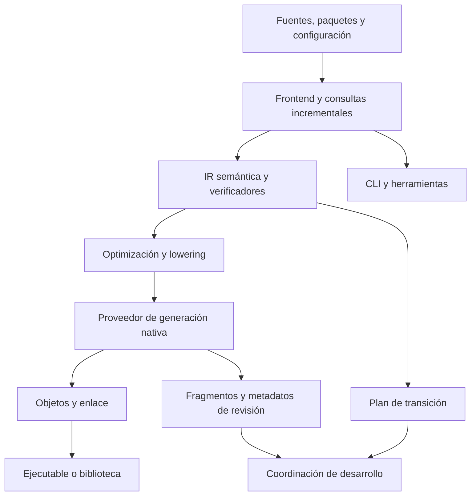

# Nexo — Arquitectura maestra del compilador propio

## Revisión documental 3.1 — Compilación integral, evolución nativa y autoalojamiento

| Campo | Valor |
| --- | --- |
| Estado | **Arquitectura candidata actualizada; pendiente de última revisión** |
| Dictamen recibido sobre la revisión 3 | **APTO CON CORRECCIONES**; evolución nativa aceptada como candidata para planificación experimental |
| Fecha | 25 de octubre de 2026 |
| Proyecto | Nexo — `Hackerprod/Nexo` |
| Rama estudiada | `main` |
| Commit de referencia | `1df641e79a7209beff9a09b73d5910b35226cfe0` |
| Baseline documental | `docs/baseline/Nexo_ROADMAP_rev0.2.md` y acuerdos/ADR vigentes en el commit indicado |
| Objeto de esta revisión | Completar la arquitectura integral, precisar la atomicidad sobre estado vivo y reconciliar trazabilidad; conservar los contratos de evolución revisados |
| Implementación | No realizada en esta investigación |
| Modificaciones del repositorio | Ninguna |

> **Alcance del documento.** Este es el documento maestro completo que sustituye a la revisión 3 para su última evaluación. La revisión 3.1 es una corrección documental, no una nueva ronda de diseño general ni una revisión del roadmap baseline. «Debe» expresa una obligación arquitectónica candidata, salvo cuando se atribuye expresamente a una fuente vigente. La aceptación conceptual recibida no acredita implementación, experimentos ni aprobación de fases. Se conservan íntegros N1–N12 y los contratos de transformación, resolución nativa y efectos.

### Estado de las decisiones

| Etiqueta | Alcance |
| --- | --- |
| Vigente en el repositorio | Regla atribuida a su fuente y estado documental; no se infiere implementación. |
| Candidata suficientemente definida | Obligación o frontera que este documento propone como base del roadmap experimental. |
| Alternativa abierta | Elección de algoritmo, estructura o realización que un experimento debe resolver. |
| Hipótesis pendiente | Propiedad práctica o cuantitativa que no se presenta como medida. |

La semántica y la sintaxis vigentes no se someten a cambios por conveniencia del compilador. Las concreciones que dependan de un ADR todavía propuesto conservan ese estado. La arquitectura fija cómo representar y comprobar las reglas que se aprueben, sin aprobarlas indirectamente.

### Cambios respecto de la revisión 3

| Petición de revisión | Corrección incorporada |
| --- | --- |
| Arquitectura del compilador completo | Mapa en §3.1 y subsistemas en §§13–18, con contratos, alternativas y eliminación de dependencias. |
| Atomicidad sobre estado vivo | Huella de compatibilidad en §5.7 y obligación de compromiso en §§7.2.1–7.2.2; nuevos casos adversos en §10.2. |
| Trazabilidad | D04/Cranelift, referencia D17 inexistente y enmiendas propuestas a §9.8 en §12. |
| Conservar lo revisado | §§4, 6, 8 y N1–N12 mantienen sus obligaciones; se conservan los experimentos anteriores. |
| Preparar el roadmap completo | Experimentos de todos los subsistemas en §19 y dependencias técnicas/decisiones abiertas en §20. |

**Guía de lectura.** §§1–3 definen el conjunto; §§4–11 conservan y precisan la evolución en caliente; §12 registra autoridad documental; §§13–18 desarrollan el compilador integral; §§19–21 fijan validación y cierre; §22 reúne fuentes. La numeración de §§5 y 7 se conserva para que la corrección de atomicidad sea localizable.

## 1. Resultado propuesto y situación de partida

Se propone un compilador con un único núcleo semántico que produzca tanto código nativo como planes verificables de transición entre revisiones de un programa vivo. La evolución se apoya en operaciones delimitadas, estado persistente explícito, resolución coherente de código y protección de toda ejecución futura posible.

La dirección conserva las reglas fundamentales de Nexo: los datos se copian, los recursos se transfieren y el estado compartido se declara. Mantiene la sintaxis B y la extensión `.n`; no introduce sintaxis, tipos públicos o anotaciones de recarga para facilitar al compilador su implementación. Las garantías esenciales no dependen de inteligencia artificial.

El estado del repositorio estudiado sigue siendo experimental. El prototipo utiliza Rust, comprobación semántica, IR propia y ejecución mediante intérprete de esa IR. La existencia de identidades, hashes y una operación de sustitución para desarrollo no demuestra una recarga nativa concurrente con conservación de estado. Este documento no presenta el backend nativo, el protocolo aquí definido ni el autoalojamiento como capacidades actuales. Véanse [R1], [R2] y [R7].

La arquitectura distingue tres unidades que no tienen por qué coincidir:

- **Unidad de recompilación:** parte del programa cuyo resultado depende de un cambio semántico.
- **Unidad de publicación:** conjunto coherente de artefactos y metadatos que se incorpora como una revisión.
- **Unidad de ejecución consistente:** operación que conserva una resolución de código durante su vida.

La compilación incremental debe registrar dependencias semánticas, incluyendo búsquedas fallidas y conjuntos de implementaciones cuando afecten al resultado. Las interfaces, representaciones, efectos, limpieza, constantes y configuración de destino participan en la invalidación. Una compilación incremental debe producir un resultado compatible con una compilación limpia de las mismas entradas; el ahorro de trabajo es una hipótesis de rendimiento que se medirá.

El servicio de compilación puede permanecer fuera del proceso de la aplicación. El proceso conserva solamente los componentes de ejecución y coordinación necesarios. El artefacto de producción no requiere la infraestructura de desarrollo cuando su funcionalidad no la necesita.

**Situación de cierre:** el dictamen recibido acepta la evolución nativa como candidata para planificación experimental y pide completar este documento maestro. Las correcciones siguientes no alteran esa dirección. Se solicita una última revisión de la integridad del conjunto y, si no aparecen contradicciones nuevas, cerrar la investigación arquitectónica para diseñar el roadmap. Su corrección implementada, cobertura práctica y coste siguen pendientes de demostración.

## 2. Decisiones conservadas y correcciones de las revisiones

| Elemento | Decisión vigente |
| --- | --- |
| Núcleo semántico | Un único sistema de reglas de tipos, propiedad, préstamos, efectos, errores y limpieza para las distintas realizaciones. |
| Representación interna | IR propia que conserva las obligaciones necesarias antes de reducirlas a instrucciones de máquina. |
| Identidad | Separar declaración, revisión de implementación, representación de datos y origen de código fuente. |
| Aplicaciones permanentes | Extraer pasos nativos elegibles sin exigir el retorno de la función principal. |
| Consistencia | Fijar un contexto de revisión por operación y conservarlo en sus llamadas y descendientes causales. |
| Referencias antiguas | Separar protección física de código e incompatibilidad con una transición concreta. |
| Coordinación inicial | Un único coordinador, con un conjunto afectado calculado conservadoramente; no esperar a que desaparezcan todas las referencias históricas. |
| Backend inicial | LLVM principal en desarrollo y optimización; contingencia experimental Cranelift según D04. No se exige construir antes todos los emisores y enlazadores propios. |
| Independencia final | Compilador y componentes fundamentales en Nexo, autoalojamiento, generación nativa propia y eliminación comprobable de herramientas transitorias obligatorias. |
| Equivalencia entre revisiones | No se exige igualdad de comportamiento entre versiones distintas ni equivalencia general con un arranque nuevo. Se exige un contrato explícito de transición. |
| Alcance inicial | Sin sustitución arbitraria de pilas, migración general de esquemas vivos o actualización general de continuaciones suspendidas. |

La propuesta de adelantar obligatoriamente un backend propio completo, formulada en la primera revisión, queda retirada. Se conserva LLVM inicialmente, conforme a D04 y a la secuencia de independencia de [R3] y [R4]. Un emisor pequeño futuro solo se justificaría mediante una pregunta experimental concreta o como parte de la sustitución planificada.

La independencia final admite hardware, sistema operativo e interfaces nativas. Un wrapper escrito en Nexo alrededor de un componente externo obligatorio no demuestra su eliminación. La cadena de arranque deberá fijar fuentes y herramientas, producir generaciones sucesivas del compilador y reconstruirse en un entorno sin las dependencias transitorias. Un punto fijo de autoalojamiento acredita reproducción bajo condiciones definidas, no corrección completa.

## 3. Vocabulario y separación de garantías

| Concepto | Significado en este documento |
| --- | --- |
| Revisión lógica | Manifiesto inmutable de implementaciones, contratos, representaciones, continuaciones y dependencias. |
| Artefacto nativo | Código máquina y metadatos asociados a una identidad de implementación y a dependencias acreditadas. |
| Operación reconocida | Ejecución admitida en una frontera definida por el compilador o por un componente del runtime con contrato conocido. |
| Paso | Realización nativa de una unidad de ejecución; en el primer transformador, condición y cuerpo completo de una iteración elegible. |
| Marco persistente | Objeto explícito que conserva los valores y obligaciones que sobreviven entre pasos. |
| Raíz ejecutable | Operación, callback, closure, continuación, limpieza u otra referencia desde la que todavía puede ejecutarse código. |
| Protección de código | Referencia que mantiene disponibles instrucciones y metadatos mientras puedan utilizarse. |
| Entrada estable | Dirección nativa registrada cuyo binding adquiere o hereda un contexto conforme a un contrato conocido. |
| Plan de transición | Comparación entre una revisión base concreta y una candidata, con obligaciones estáticas y condiciones sobre el estado vivo. |

Se distinguen tres garantías:

1. **Corrección de compilación:** compilar u optimizar una versión conserva su semántica definida.
2. **Seguridad de transición:** la actualización conserva las invariantes de tipos, representación, acceso, recursos y efectos que su contrato acredita.
3. **Corrección funcional:** el comportamiento nuevo satisface los requisitos de la aplicación sobre el estado heredado.

La tercera no se deduce automáticamente de las dos primeras. Un cambio de significado de metros a centímetros puede conservar tipos y layout. Una transacción de negocio puede comenzar en un fotograma y terminar en otro sin que las reglas de propiedad revelen ese límite. No se promete preservar automáticamente invariantes que el programa no expresa.

### 3.1. Mapa del compilador completo

El eje común es un **núcleo semántico propio**, con revisiones inmutables de entrada y representaciones verificadas. De él se obtienen diagnósticos, código, interfaces de módulos y evidencias para comparar revisiones. El mecanismo de recarga consume esos resultados; no mantiene un segundo comprobador del lenguaje.

El proveedor inicial es LLVM. El proveedor propio incorporará IR de máquina, selección, asignación de registros y codificación. No son dos lenguajes ni dos núcleos permanentes: la coexistencia durante la sustitución tiene propósito, alcance y criterio de retirada. La contingencia Cranelift mantiene exclusivamente el papel delimitado en §12.1.

| Frontera | Producto y responsabilidad | Desarrollo posterior |
| --- | --- | --- |
| Entrada → frontend | Snapshot coherente, sintaxis B y procedencia | §13 |
| Frontend → IR semántica | Significado resuelto y obligaciones de tipos, acceso, recursos y efectos | §§13–14 |
| IR → proveedor nativo | Operaciones verificadas, layouts, ABI, dependencias y política de realización | §§14–15 |
| Generación → enlace/carga | Bytes o fragmentos, símbolos, relocaciones y metadatos con contratos | §§15–16 |
| Imagen → sistema | Arranque, runtime necesario e interfaces nativas declaradas | §17 |
| Fuentes Nexo del compilador → siguiente generación | Cadena de arranque reproducible y auditable | §18 |

Las fronteras describen responsabilidades y datos, no obligan a desplegar un proceso por subsistema. El primer compilador puede ser secuencial y local. El servidor incremental comparte el núcleo con CLI/LSP; la aplicación solo recibe el soporte de ejecución que necesita.

## 4. Contrato de transformación de bucles

### 4.1. Tres comprobaciones independientes

| Comprobación | Pregunta |
| --- | --- |
| Extracción correcta | ¿La ejecución mediante controlador, marco y pasos conserva el comportamiento sin actualizaciones? |
| Frontera utilizable | ¿Las obligaciones vivas y los contratos permiten coordinar allí una actualización? |
| Transición compatible | ¿Una revisión nueva concreta puede continuar desde el estado vivo concreto? |

Un bucle puede superar la primera comprobación y no las otras. La imposibilidad de recargarlo no convierte un programa válido en inválido.

**Regla fundamental:** el retorno interno de un paso no termina por sí mismo un ámbito semántico del programa fuente.

### 4.2. Elegibilidad sobre la IR

La selección se realiza sobre la IR con nombres, tipos, acceso, inicialización y limpieza explícitos. No se basa en un patrón textual semejante a un bucle de fotogramas.

| Condición del primer transformador síncrono | Comprobación requerida |
| --- | --- |
| Región delimitada | Grafo de control reducible, entrada única y entradas/salidas conocidas. |
| Corte completo | Todas las vueltas de la iteración, incluidos sus `continue`, llegan al corte correspondiente antes de reevaluar la condición. |
| Salidas explícitas | Cada salida de bucle, retorno y propagación de error tiene destino y limpieza definidos. |
| Estado representable | Todo valor, lugar, préstamo y obligación que sobreviva tiene representación conocida y válida durante ese intervalo. |
| Control soportado | El paso no contiene suspensión ni transferencias extranjeras opacas que este transformador no pueda representar. |
| Efectos preservables | Transformación e instrumentación no requieren operaciones prohibidas por los ámbitos originales. |

Entrada única y reducibilidad limitan el primer algoritmo; no declaran imposibles otras transformaciones. Los bucles anidados permanecen dentro de la operación exterior y no adquieren automáticamente fronteras de actualización propias.

El corte se sitúa antes de evaluar la condición. Evaluar la condición con una revisión y el cuerpo con otra introduciría una mezcla no admitida.

### 4.3. Cálculo del estado persistente

La vivacidad computacional no basta. El conjunto transportado en un corte incluye:

$$
S_c = V_{\mathrm{uso\ futuro}}
\cup V_{\mathrm{limpieza\ pendiente}}
\cup V_{\mathrm{referencias\ vivas}}
\cup V_{\mathrm{control\ e\ inicializacion}}.
$$

- **Uso futuro:** condición siguiente, iteraciones posteriores y continuaciones de salida.
- **Limpieza pendiente:** recursos cuyo último uso terminó, pero cuyo ámbito aún no concluyó.
- **Referencias vivas:** bases y subobjetos alcanzables mediante préstamos o referencias que sobreviven.
- **Control e inicialización:** valores de salida, discriminantes, construcción parcial y obligaciones pendientes.

El análisis sigue los caminos y relaciones de propiedad de la IR. El descriptor conserva identidad de lugares, tipos nominales, representaciones, posiciones, tamaños, alineamientos, máscaras de inicialización, propietarios, préstamos, limpieza, afinidad y estabilidad de dirección.

La identidad de un lugar procede de declaraciones y lugares resueltos junto con la continuación; no de su offset, línea de fuente o numeración temporal SSA. Entre revisiones se exige correspondencia inequívoca. Los hashes aceleran la comparación, pero no sustituyen el examen de contratos y descripciones verificadas.

### 4.4. Equivalencia sin actualizaciones

Debe existir una relación de simulación entre el estado original y el controlador, marco y paso transformados. La relación conserva valores, lugares, inicialización, propietarios, préstamos y limpiezas pendientes.

Cada operación observable original corresponde a la misma operación transformada, en el orden exigido. Los pasos administrativos no pueden:

- Repetir condiciones o inicializadores.
- Añadir, eliminar o reordenar efectos observables.
- Cambiar errores comprobados o su procedencia fuente.
- Introducir copias semánticas o duplicar recursos.
- Terminar o ampliar artificialmente préstamos.
- Introducir divergencia administrativa en una ejecución terminante.
- Incumplir contratos de recursos.

La equivalencia respeta P01 y P04: observaciones definidas, no igualdad física de instrucciones, tiempos o direcciones entre compilaciones. En concurrencia se preservan comportamientos admitidos y obligaciones de progreso, no un intercalado físico particular. Los fallos ambientales siguen su política documentada; no se promete idéntico agotamiento físico de memoria entre realizaciones. [R3]

La transformación y la instrumentación se verifican separadamente. La corrección de la extracción no autoriza después a insertar un mutex en cualquier ámbito.

### 4.5. Préstamos, recursos y salidas

Un préstamo que cruza un corte conserva raíz, proyecciones, permiso y dependencia de otros préstamos. No se termina y recrea para permitir accesos originalmente prohibidos. Un recurso persistente conserva su propietario; prestar internamente el marco al paso no transfiere todos sus recursos en cada iteración.

| Salida | Obligación |
| --- | --- |
| Final normal | Limpiar solo los ámbitos que terminaban en esa iteración y volver al corte. |
| `continue` | Limpiar los ámbitos abandonados y alcanzar el destino correcto. |
| Condición falsa | No ejecutar el cuerpo; seguir la salida original. |
| `break` | Limpiar los ámbitos abandonados y ejecutar el postámbulo correspondiente. |
| `return` | Evaluar una vez el resultado, conservar su propiedad y ejecutar la limpieza original. |
| Propagación con `?` | Conservar rama, valor propagado y secuencia de limpieza de la IR. |
| `panic` | Mantener la política abortiva; no inventar recuperación o retorno normal. |

El resultado interno del paso puede codificar destino y valor de salida; no constituye un nuevo tipo público. Las máscaras de inicialización gobiernan la limpieza. No se destruyen indiscriminadamente todos los campos al salir.

### 4.6. Ejemplos de aceptación y rechazo

**Aceptado.** Una función abre un archivo, crea una posición y un contador y entra en un bucle exterior. En cada vuelta evalúa la condición, presta temporalmente la posición a un cálculo, termina ese préstamo, escribe un resultado y limpia temporales. Archivo, posición y contador permanecen en el marco. El archivo conserva identidad y se limpia al abandonar su ámbito original.

**Rechazado por el transformador síncrono inicial.** Un bucle válido de una función asíncrona se suspende a mitad del cuerpo y luego continúa usando sus locales. Devolver control no significa terminar la iteración. Necesita integrar la continuación suspendida y queda fuera de este transformador, sin invalidar el programa ordinario.

**Extraíble, pero con frontera no utilizable.** Un bucle mantiene durante todas sus vueltas una guarda que excluye a otro participante. Puede representarse en el marco; no puede liberarse en el retorno interno. Si coordinar exige esperar a alguien que necesita esa exclusión, estacionarse allí produciría interbloqueo y la frontera se rechaza.

La extracción de bucles tiene antecedentes, incluido el tratamiento del postámbulo. No se presenta como invención de Nexo. [R9]

## 5. Contrato de referencias permanentes y coordinación

### 5.1. Protección física y compatibilidad

«Todavía podría ejecutarse esta imagen» obliga a retenerla. «Todavía podría ejecutar comportamiento incompatible con esta transición» puede impedir además la publicación. Una referencia antigua no bloquea por antigüedad.

Para cada raíz ejecutable se conserva una clausura conservadora de código, enlaces, estado, representaciones, limpieza, contratos y referencias externas. Incluye llamadas directas e indirectas, especializaciones, inlining, constantes, entornos y direcciones de funciones que pueda crear, almacenar o exportar, aunque no las invoque de inmediato.

Sea $\Pi_x(M_r)$ la proyección cerrada del manifiesto de la revisión $r$ que puede utilizar la raíz $x$. Una condición suficiente inicial para considerarla compatible es:

$$
\Pi_x(M_r) \equiv \Pi_x(M_{r'})
\;\land\;
\operatorname{EstadoVivoCompatible}(x,r,r').
$$

La equivalencia es estructural y conservadora; no demuestra equivalencia arbitraria de algoritmos distintos. La compatibilidad viva incluye identidad de objetos, representación, inicialización, acceso y limpieza pendiente. Un protocolo compartido cuya compatibilidad no se pueda acreditar se trata como afectado.

### 5.2. Callback permanente y cambio independiente

Supóngase que `AlCerrarVentana` marca un indicador de salida y que únicamente cambia `ActualizarMovimiento`. Si el código, entorno, dependencias y obligaciones del callback permanecen compatibles, puede seguir registrado y mantener protegida su imagen. El coordinador espera las operaciones afectadas por Movimiento y publica la nueva revisión sin cerrar la ventana.

El indicador de salida debe seguir siendo **el mismo objeto persistente**. Un callback antiguo que escribe un objeto y un bucle nuevo que lee otra copia no conservan estado compartido aunque ambos símbolos se llamen igual. Estado e imagen de código tienen identidades separadas.

Si el callback puede alcanzar Movimiento por cualquier vía acreditada, incluida una función que expone para uso posterior, ya no es ajeno. Observar que su última invocación no lo hizo no demuestra independencia.

### 5.3. Dos clases de entrada externa

| Entrada | Regla |
| --- | --- |
| Evento independiente nuevo | Adquiere conjuntamente revisión, destino compatible y protección al admitirse. |
| Callback o continuación causal | Conserva el contexto de la operación existente. |

Un binding administrado puede registrar una dirección estable con identidad del destino, ABI, entorno, afinidad, vida útil y forma de entrada. La clasificación procede de ese contrato; no de que la llamada venga de una biblioteca, estuviera inactiva o llegue en otro hilo.

Un callback síncrono reentrante hereda el contexto anterior. Una continuación transferida de hilo conserva su token causal mediante el registro correspondiente. TLS por sí solo no acredita esa relación.

No se convierte silenciosamente un puntero nativo directo observable en una entrada redirigible. El puntero fijo conserva el destino y la protección de su contrato. Un trampoline estable tampoco demuestra compatibilidad del entorno capturado.

### 5.4. Qué significa desconocido

- **Vida útil desconocida, destino conocido:** puede exigir retención indefinida sin impedir cambios ajenos.
- **Alcance desconocido:** impide acreditar independencia respecto del cambio.
- **Contrato externo asumido:** pertenece a la frontera de confianza y no se etiqueta como prueba estática de Nexo.

### 5.5. Coordinador único, conjunto afectado preciso

El primer coordinador sigue siendo único, pero no exige extinguir todas las referencias históricas. Para cada transición identifica raíces afectadas, conserva las compatibles, cierra entradas nuevas incompatibles, permite terminar descendientes anteriores y revalida el inventario antes de publicar.

Desde el principio se conservan dependencias cerradas, identidades de objetos, relaciones de alias, resúmenes de acceso, causalidad y referencias ejecutables. Esto permite refinar posteriormente dominios sin redefinir toda la ABI o el modelo de propiedad. La precisión del conjunto afectado y el número de coordinadores son decisiones distintas.

### 5.6. Espera indefinida e interbloqueos

| Situación | Regla |
| --- | --- |
| Operación antigua espera callback causal | El callback sigue admitido con su contexto anterior. |
| Despachador debe ejecutar trabajo pendiente | No se estaciona impidiendo ese trabajo. |
| Participante conserva bloqueo necesario para otro | Esa posición no es una frontera de espera válida. |
| Callback exige respuesta inmediata | El binding debe admitir una entrada compatible o acreditar aplazamiento; de lo contrario, la transición no está disponible. |
| Respuesta externa nunca llega | Se conserva protección, se informa y puede agotarse el presupuesto de espera. |
| Aparece una nueva referencia durante el drenaje | Se incorpora y se revalida; los contadores no se presuponen monótonamente decrecientes. |

Cancelar un intento de actualización reabre admisión de la revisión anterior. No cancela solicitudes del usuario, destruye recursos ni permite liberar código vivo. Las limitaciones de progreso no se esconden mediante una transición forzada. [R11]

### 5.7. Compatibilidad estable frente a la ejecución concurrente

El conjunto afectado incluye las operaciones capaces de invalidar las condiciones dinámicas de una transición, aunque su código no haya cambiado. La independencia respecto del código sustituido no demuestra por sí sola independencia respecto del estado que el plan necesita.

Para una transición $T$, sea $P_T(S)$ el predicado de compatibilidad sobre el estado vivo $S$: base, continuaciones, lugares, representaciones, inicialización, propiedad, préstamos, limpieza pendiente y raíces ejecutables relevantes. Solo contiene condiciones realmente requeridas por el plan; no añade invariantes funcionales que la aplicación no expresa.

El plan identifica una **huella de compatibilidad**: objetos, descriptores, relaciones y registros de los que dependen esas condiciones, junto con las vías capaces de modificarlos. Incluye creación, transferencia y destrucción de obligaciones, no solo escrituras de bytes. Un lector que prolonga un préstamo o retiene una dirección puede afectar la transición.

**Obligación candidata:** las acciones que siguen admitidas deben preservar las condiciones utilizadas hasta el compromiso, o participar en un mecanismo que ordene sus modificaciones conflictivas respecto de él. Una justificación suficiente para una condición estable es:

$$
P_T(S) \land A_T(S,S') \Longrightarrow P_T(S').
$$

$A_T$ representa toda interferencia permitida del conjunto todavía admitido, incluidos descendientes, callbacks y accesos compartidos. Esta obligación puede acreditarse por partes del predicado; no exige que todos los valores del programa permanezcan constantes.

Así, un callback de ventana puede seguir modificando el indicador de salida cuando conserva identidad, representación y acceso y no invalida ninguna condición. En cambio, transferir un recurso fuera de un lugar que el plan necesita inicializado, crear un préstamo incompatible o registrar una raíz afectada impide clasificar esa acción como ajena.

| Vía posible | Evidencia requerida |
| --- | --- |
| Estabilidad demostrada | Toda acción que sigue admitida preserva las condiciones utilizadas. |
| Drenaje y exclusión de nuevas acciones conflictivas | Las acciones invalidantes terminaron y no pueden reaparecer antes del compromiso. |
| Protección o reserva de la huella | Se cubren todas las vías de modificación relevantes durante comprobación y compromiso. |
| Validación optimista coordinada | Un protocolo completo impide comprometer una observación invalidada por interferencia. |

Las vías pueden combinarse. No se prescribe congelar todo el proceso, instrumentar cada escritura ni añadir memoria transaccional al lenguaje. En el primer alcance, mantener FrameABI y protocolos de acceso suele permitir que modificaciones ordinarias de valores preserven las condiciones; esa suficiencia debe acreditarse para cada clase admitida. Las excepciones entran en el conjunto afectado o impiden aplicar ese plan.

Toda realización respeta accesos legales, efectos y progreso de Nexo. Después del compromiso, las raíces antiguas que continúan deben seguir cumpliendo su contrato de coexistencia: una comprobación puntual no autoriza crear luego ejecución incompatible. Las obligaciones que deban durar más allá de la publicación conservan protección durante su vida exigida.

## 6. Contrato entre IR, código nativo y runtime

### 6.1. Contexto de ejecución materializado

Cada operación posee un contexto interno inmutable:

$$
C_u = (\text{revision},\ \text{resolucion de entradas},\ \text{proteccion}).
$$

Los pasos y entradas recargables lo reciben mediante una ABI interna. No es un parámetro nuevo de la sintaxis. Publicar otra revisión crea otra raíz; no muta el contexto de una operación activa.

Todo destino ejecutable de la operación debe estar acreditado por ese contexto, incluidas dependencias incorporadas y limpiezas. Conocer un número de revisión no basta.

### 6.2. Reglas de resolución nativa

| Mecanismo | Obligación |
| --- | --- |
| Llamada directa | Relocalización hacia una implementación exacta acreditada por el manifiesto. |
| Llamada indirecta | Resolución en el contexto heredado o en un destino fijo cuya compatibilidad esté acreditada; nunca consultar una tabla global de «última versión» a mitad de operación. |
| Inlining | El artefacto conserva la dependencia del cuerpo incorporado; un cambio relevante lo invalida para la candidata. |
| Especialización | Identidad que incluye argumentos, implementaciones seleccionadas y dependencias de tipos, representaciones y efectos. |
| Llamada terminal | Puede eliminar activaciones físicas, pero no protección de la operación ni limpieza pendiente. |
| Destructor | Resolución acreditada y protección hasta completar su ejecución. |
| Entrada externa | Binding que adquiere o hereda contexto, o destino concreto protegido. |

Las llamadas directas pueden permanecer directas; no se exige una consulta por cada llamada. Tablas virtuales y closures con direcciones ejecutables también participan en el contrato.

### 6.3. Datos que comparten las capas

| Capa | Información |
| --- | --- |
| IR Nexo | Identidades, llamadas, acceso, efectos, préstamos, limpieza, representaciones y fronteras. |
| Descriptor nativo | Identidad de implementación, ABI, esquema del marco, destinos, dependencias integradas/especializadas, referencias a estado y metadatos de plataforma. |
| Runtime | Contextos protegidos, operaciones, referencias retenidas, marcos vivos y propiedad de imágenes. |

El descriptor incluye inlining, propagación de constantes y selección de implementaciones. Una clausura conservadora más amplia puede recompilar de más; una dependencia real omitida puede romper la coherencia.

La publicación verifica correspondencia entre manifiesto, artefactos, enlaces, ABI y esquemas. Esto no demuestra automáticamente la corrección de todas las instrucciones: lowering, backend y primitivas siguen en la frontera de confianza de P07. [R3]

### 6.4. Fronteras frente al optimizador

Se permite optimizar dentro del paso respetando su contrato. En el primer mecanismo se prohíbe integrar el paso sustituible dentro del controlador permanente y desplazar acciones de usuario a través de la frontera sin justificación específica.

La implementación inicial puede separar unidades e impedir optimización interprocedimental a través de esa ABI. La obligación normativa es conservar la frontera; un atributo aislado no constituye por sí solo toda la garantía.

**Contraejemplo obligatorio:** `Procesar` integra una copia de `Validar` y llama indirectamente a `Registrar`. Una edición mueve un efecto entre Validar y Registrar. Si se reutiliza Procesar sin invalidar su dependencia integrada, o Registrar selecciona una tabla global nueva, se mezclan revisiones pese a que el runtime conserve una etiqueta correcta.

No se modifican instrucciones antiguas en el sitio. La candidata se prepara separadamente, y las ejecuciones anteriores conservan destinos y código acreditados.

### 6.5. Marco persistente explícito

Nexo fija antes del lowering una ABI del marco con esquema, tamaño, alineamiento, posiciones, inicialización y limpieza. El controlador reserva una vez su almacenamiento fijo y sigue activo mientras lo necesita. Los pasos reciben su dirección.

No se recuperan locales a partir de mapas del depurador ni se depende de offsets accidentales de la pila optimizada. Los objetos con estabilidad exigida se construyen en su almacenamiento definitivo; los pasos no los trasladan ni reconstruyen el marco.

LLVM atribuye significado semántico a `alloca` y a las marcas de vida del almacenamiento. Situar datos persistentes en una reserva del paso que termina al retornar, o emitir un fin de vida para ellos en cada vuelta, sería incorrecto. Tampoco se pueden emitir promesas de aliasing más fuertes o duraderas que las demostradas por Nexo. [R8]

La estabilidad exigida es durante la ejecución y mientras la semántica la requiera; no implica idénticas direcciones numéricas entre compilaciones.

## 7. Admisión, publicación y retirada

### 7.1. Adquisición protegida

El protocolo inicial utiliza un registro del supervisor protegido por un mutex. Admisión y adquisición de la protección ocurren conjuntamente respecto de publicación y retirada:

1. Comprobar si se admite la operación.
2. Obtener revisión y destino acreditados.
3. Registrar la referencia de ejecución.
4. Liberar el registro y ejecutar sin mantener el mutex del supervisor.

Leer un puntero y después incrementar un contador atómico deja una ventana en la que podría haberse liberado. La protección se adquiere junto con el acceso a la raíz. Las llamadas internas heredan el contexto y no adquieren una revisión nueva.

### 7.2. Transición y compromiso respecto del estado vivo

| Estado | Acción y condición |
| --- | --- |
| Preparación | Compilar y verificar la candidata, resolver dependencias y preparar código/metadatos sin hacerla alcanzable ni ejecutar inicializadores de usuario especulativos. Identificar condiciones dinámicas y huella de compatibilidad. |
| Cierre | Comprobar la base y cerrar entradas nuevas incompatibles, incluidas las capaces de invalidar condiciones que no estén cubiertas por otra vía. |
| Drenaje | Permitir finalizar operaciones afectadas y descendientes causales; conservar raíces compatibles y operaciones cuya interferencia esté acreditada. |
| Estabilización y revalidación | Establecer evidencia de estabilidad o coordinación y comprobar base, inventario, estado y obligaciones mediante observaciones válidas; la evidencia sigue vigente hasta el compromiso. |
| Compromiso y publicación | Publicar raíz y asociación acreditada con continuaciones/estado, y actualizar admisión conforme a un único orden lógico respecto de las modificaciones conflictivas. |
| Abandono del intento | Ante conflicto, evidencia insuficiente o presupuesto agotado, conservar la revisión vigente y su estado actual, liberar reservas técnicas y reabrir las entradas correspondientes. |

La candidata debe prepararse para la base realmente activa. Un plan obsoleto no se aplica por aproximación. No se espera con el mutex del supervisor adquirido ni estacionando indiscriminadamente participantes que conservan bloqueos de usuario.

#### 7.2.1. Obligación de compromiso

Debe existir un instante lógico de compromiso $t_c$ en el que:

$$
\operatorname{BaseActiva}(t_c^-)=\operatorname{Base}(T)
\quad\land\quad P_T(S(t_c^-)).
$$

$t_c^-$ designa el estado lógico inmediatamente anterior al compromiso. En $t_c^+$, la raíz publicada y la admisión de operaciones nuevas corresponden a la candidata, conservando las asociaciones de estado acreditadas y los contextos de descendientes ya admitidos. La notación identifica el orden lógico pertinente, no una instantánea física de todo el proceso.

Las modificaciones conflictivas quedan ordenadas antes o después del compromiso de forma compatible con la sincronización y semántica del programa. Ninguna puede invalidar la evidencia entre comprobar una condición y utilizarla para publicar. La raíz, los enlaces con estado y la admisión deben observarse conforme a ese mismo compromiso; una escritura atómica aislada del puntero no garantiza el conjunto.

Esta atomicidad corresponde a la transición y a los hechos de los que depende. No convierte el trabajo de usuario en una transacción global ni detiene modificaciones independientes.

**El mutex del supervisor protege su registro y la adquisición/publicación de raíces. No protege automáticamente campos, préstamos, recursos ni invariantes dinámicas del estado de usuario.** Solo acredita hechos cuyos modificadores participan realmente en ese protocolo.

La revalidación también necesita lecturas legítimas. No puede introducir carreras al inspeccionar campos no atómicos, violar préstamos ni combinar observaciones de varios campos que nunca formaron un estado compatible. Debe justificarse la consistencia de la observación sobre la huella necesaria, sin exigir una instantánea del proceso completo.

#### 7.2.2. Evidencia vigente hasta publicar

Para cada condición dinámica, la implementación presenta estabilidad frente a todas las acciones admitidas, protección durante el intervalo relevante o un protocolo de validación/compromiso que detecte u ordene cualquier interferencia antes de publicar. La evidencia debe cubrir también nuevas raíces, alias, cambios de propietario y obligaciones de limpieza.

Leer dos veces un contador y publicar después no basta: una tercera modificación puede ocurrir en la ventana final. Una técnica optimista necesita cerrar esa ventana respecto de todos los modificadores pertinentes; debe contemplar reutilización de identidades y agotamiento de generaciones. La igualdad aparente de un identificador no demuestra ausencia de interferencia.

Esta garantía no autoriza mutex o esperas bajo `no_block`, reservas bajo `no_alloc`, suspensión bajo `no_suspend`, accesos inválidos ni un cierre que impida completar descendientes. Un permiso exclusivo ya existente puede aportar evidencia, pero el compilador no inventa exclusividad ni cambia la duración de préstamos para obtenerla. Si ninguna realización disponible satisface simultáneamente las obligaciones, esa transición no se aplica mediante el protocolo inicial.

La pérdida de evidencia obliga a revalidar o abandonar. **Abandonar conserva el estado actual de la ejecución vigente; no restaura el snapshot observado ni revierte efectos de usuario ocurridos durante el intento.** Solo se deshacen recursos técnicos propios de la preparación conforme a sus contratos. Esta precisión desarrolla N4 y N9 bajo N10–N12, sin sustituir sus formulaciones.

El abandono descrito corresponde únicamente a un intento **anterior al compromiso**. Después de comprometer, un fallo de diagnóstico, mantenimiento o retirada no autoriza restaurar unilateralmente la raíz anterior. Volver a otra revisión necesita un nuevo plan compatible con el estado entonces vigente; las imágenes todavía protegidas se conservan.

### 7.3. Condición de liberación

Toda instrucción activa, dirección de retorno y referencia capaz de iniciar ejecución debe estar cubierta por protección contabilizada. Esa protección dura hasta el retorno efectivo al controlador estable, incluidos epílogos y limpieza.

Una imagen solo se libera cuando no conserva entradas publicadas, activaciones, referencias retenidas, lectores de metadatos, propietarios desde otros artefactos o referencias desconocidas que puedan utilizarla, y se ha cerrado toda vía de adquisición nueva.

Los contadores implementan ese invariante; no lo demuestran por existir. Una imagen se desconecta antes de desmontarla. Recursión y enlaces internos no deben crear ciclos de propiedad que hagan inmortal cada revisión.

Una suspensión transfiere protección a su continuación. Pedir cancelación no equivale a completar cancelación. Un destructor no libera su última protección antes de ejecutar su propio código. Retirar imágenes solo libera recursos técnicos; no ejecuta limpieza de usuario en el hilo coordinador.

La retención debe estar presupuestada. Miles de imágenes que han dejado de ser alcanzables deben liberarse. Si el programa conserva referencias legítimas de cada revisión, no se promete memoria constante: se limita la publicación antes que liberar código vivo.

## 8. Contrato de efectos de transformación e instrumentación

### 8.1. El ámbito sigue siendo la invocación fuente

Debe cumplirse:

$$
\operatorname{Efectos}(\text{implementacion completa de } f)
\subseteq
\operatorname{Permitidos}(f).
$$

La implementación completa incluye controlador, pasos, contabilidad, limpieza y ayudas transitivas. Dividir `Main` en helpers no permite sacar un mutex de su contrato `no_block`. Los efectos se comprueban después de transformación, instrumentación y ayudas introducidas por el backend. Desconocido no equivale a vacío. [R3, §6.1]

### 8.2. Preservación por contrato

| Contrato | Realizaciones que pueden respetarlo | Operaciones incompatibles |
| --- | --- | --- |
| `no_alloc` | Marco fijo, tokens existentes y capacidad preparada antes de entrar al ámbito | Reservas por paso, crecimiento oculto de registros o materialización diferida. |
| `no_heap_alloc` | Almacenamiento fijo o capacidad regional admitida | Crecimiento de región con reserva oculta al sistema. |
| `no_block` | Operaciones concretas acreditadas como no bloqueantes | Mutex, espera de quiescencia o colas bloqueantes. |
| `no_suspend` | Llamadas/retornos internos en la misma tarea sin suspensión del lenguaje | Suspensión añadida para coordinar la recarga. |
| `no_io` | Contabilidad en memoria acreditada | Watcher, IPC o trazas externas ejecutadas por la invocación. |

Un retorno nativo interno no es automáticamente suspensión del lenguaje. Un atómico tampoco acredita por sí solo que toda su realización y coordinación sean no bloqueantes. Los destinos necesarios de una ruta restringida se preparan antes de publicar; no disparan compilación o enlace al primer uso.

Los atributos LLVM son promesas al optimizador, no verificadores equivalentes de Nexo. `nosync` no equivale a `no_block`, y `nounwind` no equivale a `no_suspend`. [R8]

### 8.3. Trabajo exterior y límites

Vigilancia y compilación en un servicio externo son trabajo de la herramienta. Puede prepararse infraestructura antes de entrar realmente en una invocación restringida. El cargador y publicador también tienen efectos que se incluyen si son transitivos del ámbito.

No se permite crear salidas ficticias de la función, mover trabajo del usuario a otro hilo para dejar de contabilizarlo, ni eximir trazas o mantenimiento ejecutados por el propio ámbito por llamarse infraestructura de desarrollo.

Si el controlador permanente impide el protocolo inicial:

1. El programa sigue siendo válido y conserva sus contratos.
2. Se genera una realización que los respeta.
3. No se inserta instrumentación incompatible.
4. Se informa de la modalidad de actualización no disponible y del alcance afectado.

Los cambios independientes pueden continuar si se acredita que no alcanzan la raíz restringida. La capacidad no se degrada silenciosamente para todo el proyecto por un obstáculo local.

## 9. Invariantes normativos candidatos

Los identificadores siguientes pertenecen a esta propuesta; no sustituyen el catálogo del repositorio.

| ID | Invariante |
| --- | --- |
| N1 | Sin actualizaciones, la transformación conserva semántica definida, errores y obligaciones de progreso. |
| N2 | La frontera interna no termina ámbitos, préstamos ni recursos de la fuente. |
| N3 | El estado transportado incluye uso futuro, referencias, inicialización y limpieza pendiente. |
| N4 | Cada transición acredita correspondencia de continuaciones, estado y representación. |
| N5 | Cada operación conserva resolución coherente, incluidas indirección, inlining, especialización y limpieza. |
| N6 | La identidad del estado persistente no se duplica accidentalmente por revisión. |
| N7 | Toda entrada o referencia ejecutable adquiere protección antes de hacerse visible. |
| N8 | Publicación y liberación son distintas; antigüedad no implica incompatibilidad. |
| N9 | Una raíz solo es ajena mediante una descripción conservadora de lo que ejecuta, interpreta o expone. |
| N10 | El cierre de admisión no impide completar descendientes necesarios de operaciones admitidas. |
| N11 | La instrumentación respeta los contratos de los ámbitos semánticos originales. |
| N12 | Información insuficiente, incompatibilidad o presupuesto agotado conservan una ejecución válida; no fuerzan transición ni liberación. |

## 10. Validación y experimentos requeridos

### 10.1. Pruebas previas a cualquier actualización

Se comparará IR original y transformada sin actualizaciones para condición con efectos, todas las salidas, construcción parcial, recursos sin usos futuros, préstamos que terminan o sobreviven, estabilidad de direcciones, errores y propagación, y ausencia de crecimiento de pila/reservas por iteración.

Los oráculos no deben limitarse a comparar dos realizaciones que comparten el mismo lowering defectuoso. Se necesitan expectativas semánticas independientes y mutaciones que comprueben la capacidad del validador para detectar defectos.

### 10.2. Demostración nativa mínima

Una aplicación escrita en Nexo mantiene un bucle permanente, estado persistente, dos funciones relacionadas por operación y un archivo real abierto antes del bucle. La retención del estado, los préstamos y la limpieza atraviesan la IR y el código generado.

Un arnés puede introducir ediciones, controlar intercalados y observar llamadas al sistema. No cuenta como demostración que Rust conserve todo el estado o que el arnés sustituya manualmente punteros. Un recurso simulado tampoco sustituye la prueba con recurso real. El adaptador auditado necesario se declara como dependencia experimental, sin presentarlo como biblioteca propia ya existente.

| Caso | Resultado exigido | Invariantes principales | Estado |
| --- | --- | --- | --- |
| Ejecución transformada sin recarga | Mismas observaciones y obligaciones definidas | N1–N3, N11 | NO EVALUADO |
| Cambio en bucle permanente | Nuevo comportamiento sin terminar `Main` ni reconstruir estado | N4–N6 | NO EVALUADO |
| Efecto trasladado entre dos funciones | Ninguna omisión/duplicación por mezcla dentro de la operación | N5 | NO EVALUADO |
| Inlining más llamada indirecta | Invalidación y resolución coherentes | N5 | NO EVALUADO |
| Archivo vivo durante cambios | Misma instancia, ninguna reapertura por transición y limpieza correspondiente | N2, N3, N6 | NO EVALUADO |
| Callback permanente ajeno | Cambio independiente aplicable sin desregistrarlo | N8, N9 | NO EVALUADO |
| Callback afectado o causal | Conservación de contexto y protección | N5, N7, N10 | NO EVALUADO |
| Edición de esquema vivo incompatible | Diagnóstico y conservación de revisión válida | N4, N12 | NO EVALUADO |
| Contrato de efectos violado | Rechazo de la candidata inválida; reiniciar no se presenta como solución | N11, N12 | NO EVALUADO |
| Publicación concurrente con adquisición | Ninguna ventana de uso de memoria liberada | N7, N8 | NO EVALUADO |
| Mutación conflictiva entre última comprobación y compromiso | Ordenada respecto del compromiso, nueva revalidación o abandono; nunca evidencia obsoleta | N4, N9, N12 | NO EVALUADO |
| Callback ajeno modifica un valor compatible | Continúa la actividad y sigue siendo aplicable el cambio independiente | N8, N9 | NO EVALUADO |
| Nueva raíz o préstamo relevante durante compromiso | Creación incluida en la coordinación y el inventario acreditado | N4, N7, N9 | NO EVALUADO |
| Lectura concurrente del estado para revalidar | Observaciones legales y consistentes sobre la huella necesaria | N1, N4, N11 | NO EVALUADO |
| Abandono tras trabajo legítimo concurrente | Revisión vigente con estado actual; sin rollback del trabajo de usuario | N1, N10, N12 | NO EVALUADO |
| Fallo técnico posterior al compromiso | No restaura unilateralmente la raíz anterior ni libera imágenes protegidas | N4, N7, N8, N12 | NO EVALUADO |
| Última referencia durante destructor | Protección hasta retorno efectivo | N2, N7, N8 | NO EVALUADO |
| Callback necesario durante drenaje | El cierre no introduce interbloqueo | N10, N12 | NO EVALUADO |
| Miles de cambios distintos | Liberación de imágenes y metadatos ya no referenciados | N8, N12 | NO EVALUADO |

Las pruebas negativas deben romper una obligación identificada. Mutaciones recomendadas: adelantar un `Drop`, emitir un fin de préstamo en el corte, omitir una dependencia integrada, duplicar estado global, liberar antes del último retorno o bloquear un callback necesario para terminar.

La prueba de atomicidad fuerza una modificación conflictiva exactamente entre la última comprobación y la publicación. Debe detectar un protocolo que confíe solo en el mutex del supervisor o en dos lecturas independientes de una versión. Su positivo concurrente conserva una modificación que no invalida compatibilidad: una corrección que inmovilice innecesariamente toda actividad tampoco demuestra la precisión prevista.

### 10.3. Medición de latencia y coste continuo

Se registran guardado completado, detección/snapshot, compilación verificada, preparación nativa, compatibilidad dinámica, publicación y primer efecto observable nuevo. Se separan sus intervalos y el total de guardado a observación. La ruta modificada debe ejecutarse realmente.

También se mide el tiempo durante el que no se admiten operaciones. Una publicación breve no oculta una espera prolongada de compatibilidad.

Se comparan ejecución equivalente sin recarga, infraestructura activa sin cambios, después de una actualización y después de miles. Se informa CPU, tiempos de servicio por percentiles, memoria física, código, metadatos, almacenamiento temporal y servicio de compilación por separado, incluyendo componentes transitorios.

La revisión anterior propuso las siguientes **hipótesis numéricas, no medidas ni aprobadas como nuevas puertas del roadmap**:

| Hipótesis experimental | Alcance y cautela |
| --- | --- |
| Guardado a observación: p95 ≤ 1 s y p99 ≤ 2 s | Corpus pequeño calentado y hardware fijado antes de medir. |
| Preparado a observado: p99 ≤ 100 ms | Carga interactiva elegible de referencia; informar también todos los pendientes. |
| Objetivo secundario de 5 ms de interrupción adicional | No sustituye latencia total; su definición estadística final pertenece al protocolo experimental. |
| 10.000 cambios distintos | No crecimiento lineal de imágenes ya no referenciadas; retención legítima se informa aparte. |
| Incremento continuo ≤ 10 % de CPU o tiempo de servicio | Comparación equivalente por aplicación, sin ocultar casos desfavorables en un agregado. |

Estas hipótesis no reemplazan las puertas de compilación y rendimiento del baseline. Deben fijarse corpus, carga, plataforma, exclusiones, percentiles y reglas de decisión antes de ejecutar cada experimento. No se cambiarán después para convertir un fracaso en éxito.

La aplicabilidad se informa con dos denominadores: cambios del conjunto predefinido como compatible y todas las ediciones habituales del corpus. Rechazar casi todo puede dar un mecanismo seguro y poco útil.

## 11. Portabilidad y alcance inicial aceptado

Las garantías comunes no implican disponibilidad universal de carga dinámica. ABI, permisos de ejecución, sincronización de caché, metadatos de pila, firma y políticas de plataforma son obligaciones del destino.

La primera demostración propuesta utiliza Linux x86-64 para reducir variables. Windows, macOS y Android requieren pruebas propias. En Windows de 64 bits el código dinámico debe proporcionar los metadatos adecuados; algunas políticas pueden prohibir generarlo. Apple documenta restricciones y autorizaciones para JIT bajo Hardened Runtime. Estas capacidades no se eluden silenciosamente. [R13–R16]

El lanzamiento normal en desarrollo debe preparar vigilancia y coordinación automáticamente cuando el entorno lo permite. No se exige al desarrollador añadir hooks de recarga o configurar un watcher externo. Si falta una capacidad, se diagnostica; no se oculta mediante un reinicio que pierda estado.

El primer alcance acepta pasos síncronos elegibles, esquemas vivos compatibles y bindings cuyo alcance pueda acreditarse. Excluye migración general, OSR arbitrario, modificación general de continuaciones suspendidas, entradas opacas y controladores cuyos contratos impidan la coordinación elegida. La ausencia de esas capacidades no debilita las garantías del código ordinario.

En el corte inicial, el prefijo de inicialización, el controlador estable y el postámbulo pendiente mantienen la misma definición semántica y las mismas dependencias relevantes. No se reejecuta un inicializador porque cambió su fuente. Una modificación de estas partes exige otro plan y queda fuera de este primer alcance.

## 12. Compatibilidad documental y límites de aprobación

La semántica fundamental, sintaxis B y baseline rev0.2 se conservan. El documento no reemplaza sus reglas ni aprueba capacidades pendientes. [R2–R6]

### 12.1. Papel vigente de LLVM y la contingencia Cranelift

D04 conserva Rust e IR propia como arranque y **LLVM como backend nativo principal de F2**, con configuraciones de desarrollo y optimización. También conserva una contingencia concreta: en F2, un adaptador experimental pequeño a Cranelift para escalares, llamadas y limpieza, sometido a pruebas diferenciales. No es soporte completo ni una segunda implementación íntegra por adelantado. [R3, D04]

La ampliación de esa contingencia depende de las puertas y el desglose de F2: si falla la puerta de edición y generación/enlace es el cuello de botella, se amplía el backend rápido o se presenta una solución equivalente medida antes de F6. Un cuello de inferencia o monomorfización exige corregir ese componente. La producción conserva LLVM conforme al baseline; promover otro backend de desarrollo exige pasar el corpus completo en los destinos distribuidos. [R3, D04 y F2]

Esta arquitectura **no cancela la contingencia**, no la convierte en backend permanente ni atribuye a Cranelift prestaciones medidas de Nexo. La interfaz común permite realizar el experimento previsto sin duplicar frontend. Sustituir posteriormente LLVM como dependencia obligatoria sigue siendo una decisión expresa bajo §9.2, después de la validación de extremo a extremo y con las puertas pertinentes. Conservar LLVM opcional durante una transición de calidad no permite declarar cumplida una puerta que el backend propio todavía falla. [R4, §9.2]

### 12.2. Fuentes existentes y referencia pendiente de VISION

| Fuente en el snapshot | Papel y estado que se respeta |
| --- | --- |
| Baseline rev0.2 | Conserva sus principios, entregables y puertas; este documento no lo modifica ni crea rev0.3. |
| F0_ACUERDOS §9.1–§9.3 | Directivas de autoalojamiento, backend propio y bibliotecas propias; el propio §9 las rotula como decisiones abiertas que necesitan ADR y validación. |
| F0_ACUERDOS §9.8 | Directiva de recarga y niveles propuestos; sus formulaciones requieren las reconciliaciones siguientes. |
| F0-D15 | Fuente de la sintaxis oficial B y `.n`; no se recuperan grafías históricas por conveniencia de implementación. |
| D11, D12 y D13 | Sus concreciones se usan con el estado de propuesta/validación que indique cada documento. Su presencia no acredita implementación ni aprobación automática; D13 se rotula iteración 6 pendiente de nueva validación en este snapshot. |
| VISION.md | Documento orientador subordinado a las fuentes normativas; no sustituye un ADR. |

**La ruta `docs/adr/F0-D17-autoalojamiento-y-backend.md`, citada en VISION.md, no corresponde a un archivo existente en el árbol del commit `1df641e79a7209beff9a09b73d5910b35226cfe0`.** Se comprobó el inventario de `docs/adr/`. Esa referencia es una deuda de trazabilidad, no evidencia de un ADR aprobado. La dirección de arranque y backend se fundamenta aquí en D04, §9.1–§9.2 y las decisiones explícitas del propietario. Corresponderá corregir el enlace o registrar la decisión revisada en el documento que se acuerde; esta entrega no crea ni presupone D17. [R3–R6]

### 12.3. Registro de enmiendas necesarias a §9.8

Todas las filas siguientes son **enmiendas propuestas, pendientes de registro/aprobación documental**. Precisar su contenido aquí no modifica F0_ACUERDOS ni el baseline.

| ID local | Formulación que necesita reconciliación | Enmienda propuesta y motivo |
| --- | --- | --- |
| E98-01 | Regla 1: solo «aplicable» o «requiere reiniciar» | Distinguir candidata inválida, aplicable, pendiente de condición viva, incompatible con este estado y modalidad no disponible. Esperar no equivale a aplicar; reiniciar no corrige un programa inválido. |
| E98-02 | Regla 2: llamador incumple contrato → «requiere reiniciar» | Rechazar la candidata inválida con diagnóstico semántico. Una edición válida pero incompatible con el proceso vivo es otra categoría. |
| E98-03 | H1: cambiar una entrada de tabla; H2 asociado genéricamente a indirección | Separar sustitución de una definición de transición viva. Exigir contexto coherente, estado, protección y vínculos nativos de §§5–7. No se exige indirección en cada llamada. |
| E98-04 | Regla 3: punto seguro y fin de marcos antiguos | Añadir corrección de extracción, operaciones delimitadas y retención por raíces. `Main` no tiene que terminar; una referencia compatible no impide publicar. |
| E98-05 | Regla 4: modificar cuerpo suspendido se trata como cambio de layout o reinicio de tarea | Comprobar la compatibilidad real; conservar la continuación antigua protegida. La actualización de continuaciones y el reinicio/cancelación de tareas no se autorizan automáticamente. |
| E98-06 | Regla 5: préstamos/regiones anteriores | Precisar que bloquean cuando sus obligaciones son incompatibles; nunca terminar préstamos o destruir recursos para fabricar compatibilidad. |
| E98-07 | Regla 6: recarga no modifica estado | Conservar identidad y obligaciones sin migración implícita. El programa puede seguir mutando estado; §§5.7/7.2 obligan a preservar o coordinar los hechos que justifican el compromiso. |
| E98-08 | Regla 7: equivalencia general con ejecución limpia | Sustituir esa formulación por corrección de cada versión y contrato explícito de transición. No reinicializar estado, no prometer equivalencia funcional arbitraria ni descartar historia observable. |
| E98-09 | Ganchos: identidad/hash y H1 «casi gratis» | Mantener identidades y dependencias como infraestructura necesaria; retirar la inferencia de suficiencia o coste no medido. La unidad incremental se determina por dependencias, no por un hash aislado. |

H0 conserva el significado de reconstrucción/reinicio; no satisface por sí solo la recarga viva exigida. H3 y la migración general siguen fuera del primer alcance y requieren decisión propia. El vínculo con las fases debe reconciliar que F2 del baseline excluye hot reload avanzado, sin fingir que este nuevo alcance ya formaba parte de esa puerta. [R3, F2; R4, §9.8]

### 12.4. Frontera documental de independencia

§9.3 exige bibliotecas fundamentales en Nexo y contiene una formulación «sin libc ni bibliotecas en C». La independencia admitida por el propietario conserva interfaces nativas del sistema. Por ello, §17 delimita responsabilidades: una biblioteca obligatoria del sistema no se presenta como código propio, y un runtime ajeno no se disfraza de interfaz del sistema. La lectura que prohibiera universalmente bibliotecas nativas de plataforma necesita aclaración documental antes de prometerla en todos los destinos. Esta precisión no reabre LLVM inicialmente ni autoriza dependencias fundamentales permanentes ocultas. [R4, §9.3; R23]

## 13. Frontend, comprobación semántica e incrementalidad

### 13.1. Entrada coherente y sintaxis

**Decisión candidata.** Cada petición opera sobre un snapshot identificable de fuentes, manifiestos, dependencias, configuración y destino. Guardar otro archivo crea una revisión nueva; no cambia los bytes que un análisis anterior está utilizando. Los eventos del watcher y las fechas de modificación ayudan a detectar cambios, pero no constituyen identidad suficiente para reutilizar resultados.

El frontend contiene gestión de fuentes, lexer y parser de sintaxis B, procedencia y recuperación de errores. Debe conservar tokens, comentarios y posiciones cuando las herramientas los necesitan, sin obligar a duplicarlos en todas las representaciones posteriores. Un árbol recuperado sirve para el editor; no acredita una unidad ejecutable. Nunca se sustituye silenciosamente una parte inválida por su significado anterior para producir una compilación aparentemente válida.

Parser, formateador y herramientas comparten reglas y componentes de análisis. Un formateo debe conservar la estructura sintáctica significativa y la semántica, aunque cambien posiciones o trivia. La técnica concreta —reanálisis de archivo, de región o árbol persistente— queda abierta a mediciones. Se puede comenzar con un parser sencillo si su interfaz admite evolución y su diagnóstico satisface el corpus; no se exige un algoritmo incremental complejo antes de demostrar su beneficio.

### 13.2. Nombres, identidad e interfaces

La resolución separa identidad de paquete, módulo, declaración, tipo nominal, cuerpo, representación y especialización. La ubicación textual localiza un origen; no basta para decidir continuidad entre revisiones. Si una correspondencia de entidades resulta ambigua, se invalida el resultado o se rechaza esa transición, en lugar de fabricar una identidad mediante coincidencias de líneas.

El grafo de paquetes se fija como entrada reproducible y aplica las reglas de coherencia vigentes. La arquitectura reserva lugar para contratos de módulo, exportaciones y selección de implementaciones; no da por aprobadas las concreciones pendientes de D13. Los ciclos de análisis se tratan conforme a las reglas del lenguaje: agrupar dependencias mutuamente necesarias no convierte un ciclo de paquetes prohibido en válido.

Una interfaz utilizada por clientes debe contener, cuando sean relevantes: identidad nominal, firmas, restricciones genéricas, procedencia/retención de vistas, efectos por operación, limpieza, representación expuesta, constantes y obligaciones de especialización. El cuerpo de un destructor, una constante incorporada o un cuerpo integrado pueden ser dependencia de un artefacto aunque la firma pública permanezca idéntica.

Además del resultado se conserva **por qué se resolvió así**: ámbito consultado, candidatos, importaciones e implementaciones que influyeron. Una búsqueda fallida también depende del conjunto en el que no encontró nada. Añadir una declaración o una implementación puede invalidar un resultado sin editar su archivo consumidor.

### 13.3. Comprobación semántica única

| Responsabilidad | Resultado exigido antes de su reducción nativa |
| --- | --- |
| Tipos e inferencia | Tipos resueltos, conversiones autorizadas y errores explicables; inferencia local e interfaces explícitas donde las reglas lo requieran. |
| Traits y genéricos | Cuerpo comprobado contra sus requisitos, selección coherente y obligaciones de instanciación. |
| Control e inicialización | Caminos, resultados y estados parciales conocidos, incluidos retorno y propagación de errores. |
| Propiedad y acceso | Copias independientes, transferencias, lugares y procedencia de préstamos con permisos comprobados. |
| Recursos | Limpieza explícita en todos los caminos pertinentes; transferencia y abandono sin duplicación ni pérdida indebida. |
| Efectos | Resumen transitivo que incluye limpieza, indirección, especialización y ayudas; desconocido permanece identificado. |
| Evaluación estática y derivación | Solo capacidades ya autorizadas, límites definidos y código resultante sometido al mismo comprobador. |

Las capacidades todavía no implementadas no se consideran disponibles porque tengan una fila. D08 establece monomorfización inicial para llamadas estáticas y despacho dinámico explícito; esta arquitectura conserva esas decisiones. D03 establece evaluación estática pura y acotada y derivación sobre metadatos autorizados: no se introduce ejecución arbitraria del compilador ni un sistema de macros nuevo para facilitar el autoalojamiento. [R3, D03, D08 y F1]

El orden de los solucionadores puede iterar cuando tipos, selección y efectos dependan entre sí. Se necesitan reglas de terminación y presupuestos, no inferencia global ilimitada. Un límite alcanzado produce un diagnóstico de capacidad del análisis, no permiso para omitir comprobaciones. Se conservan cadenas de requisitos hasta el origen que explica el fallo.

### 13.4. Consultas e invalidación

**Contrato candidato.** Una consulta recibe claves semánticas y una revisión de entradas; registra todas las dependencias que pueden alterar su resultado. Puede devolver una interfaz, cuerpo tipado, diagnóstico, representación o artefacto. CLI, LSP y compilación utilizan este mismo motor. [R3, D04]

La política inicial puede combinar consultas por módulo/interfaz y por cuerpo. No se promete que cada token sea una unidad eficiente. Los conjuntos de dependencias pueden ser conservadores; omitir una dependencia real es un defecto de corrección, mientras que incluir una innecesaria cuesta tiempo.

| Cambio | Trabajo que puede invalidar |
| --- | --- |
| Cuerpo privado sin cambios de resumen | Artefacto del cuerpo y consumidores que incorporan o especializan ese contenido. |
| Efecto, procedencia o limpieza pública | Comprobación de clientes y realizaciones que asumían el contrato anterior. |
| Tipo, layout o ABI | Representaciones, especializaciones, llamadas y esquemas vivos dependientes. |
| Constante, derivación o selección de impl | Resultados que incorporaron el valor o la decisión. |
| Nuevo nombre o candidato | Búsquedas previas, incluidas las fallidas y decisiones de ambigüedad/coherencia. |
| Destino, opciones, versión del compilador o biblioteca | Toda entrada derivada cuyo significado o realización pueda cambiar. |

La igualdad de resultados permite cortar propagación cuando se acredita que los consumidores observan el mismo resumen; no cuando solo coincide el nombre. Una compilación limpia e incremental de las mismas entradas debe tener decisiones semánticas y diagnósticos pertinentes equivalentes. Los artefactos declarados reproducibles cumplen además §18.4.

La cancelación de análisis obsoleto es una optimización de trabajo: no publica resultados parciales como completos. Cada diagnóstico lleva su revisión. Un plan de recarga especifica tanto el snapshot fuente candidato como la revisión viva base; pertenecer a las fuentes más recientes no vuelve compatible un plan preparado para otra base.

Reutilizar un cuerpo tipado o fragmento no autoriza a reutilizar su imagen ya enlazada si han cambiado destinos exactos de llamadas. Pueden requerirse nuevas relocaciones o una nueva realización nativa sin repetir el análisis semántico del llamador. N5 y §16 gobiernan esa reutilización física.

### 13.5. Memoria, almacenamiento y escalabilidad

Se propone conservar en memoria la revisión activa y resultados de uso reciente, persistir resultados costosos seleccionados y recalcular lo expulsado. No es necesario guardar todos los árboles y todas las IR de cada edición. Arenas por unidad/revisión, tablas compactas e identificadores tipados son candidatos de implementación; la elección depende de perfiles y de la vida real de las referencias.

Las claves de caché incluyen esquema del compilador, reglas semánticas relevantes, contenido/configuración, destino, opciones y dependencias. Deserializar exige validar formato, integridad, procedencia y referencias; una caché incompatible o corrupta se descarta o diagnostica. Un hash no demuestra corrección del contenido ni permite aceptar artefactos de origen desconocido como si hubieran pasado las comprobaciones.

Se presupuestan separadamente memoria del frontend, instanciaciones, IR activas, workers, caché persistente y temporales. Se limita el paralelismo por presupuesto, no solo por número de núcleos. La expulsión de una caché del compilador nunca autoriza retirar código protegido por la aplicación.

Las mediciones incluyen carga fría, ediciones calientes, alternancia de proyectos, invalidación amplia y agotamiento. Un cambio en una interfaz central puede exigir recompilar casi todo. El objetivo verificable es evitar trabajo sin dependencia causal y controlar recursos, no prometer coste proporcional a caracteres editados.

## 14. Representaciones intermedias y optimización

### 14.1. Capas con responsabilidades explícitas

| Representación | Conserva | Consumidores y motivo |
| --- | --- | --- |
| Sintaxis y origen | Estructura de fuente, tokens, posiciones, recuperación | Parser, formateador, editor y diagnósticos. |
| Representación resuelta y tipada | Declaraciones, tipos, selección de operaciones y construcciones fuente | Inferencia, interfaces, genéricos y explicaciones semánticas. |
| IR semántica de control y recursos | CFG, valores, lugares, acceso, inicialización, copia/transferencia, errores, efectos y limpieza | Verificación, transformaciones, interpretación experimental y planes de evolución. |
| IR de máquina propia | Operaciones legales del destino, registros virtuales, restricciones de llamadas/pila y referencias simbólicas | Selección, asignación, codificación y metadatos del backend propio. |

Son responsabilidades, no cuatro copias completas obligatorias. Las capas semánticas pueden compartir estructuras y consumirse progresivamente si se conservan verificabilidad y origen. La IR de máquina propia se incorpora con ese backend; LLVM recibe un lowering adecuado desde la IR semántica, sin un viaje artificial por instrucciones de Nexo para reconstruir LLVM IR.

Los esquemas internos tienen versión y verificadores. El formato persistido no usa direcciones del proceso ni números temporales como identidad estable. Su compatibilidad entre versiones del compilador se declara, no se presupone.

### 14.2. Qué permanece explícito y cuándo puede desaparecer

La IR semántica debe expresar operaciones que el código máquina no permite reconstruir de forma fiable: independencia de copia, transferencia de recursos, proyecciones de lugares, préstamos, construcción parcial, limpieza por camino, propagación de `Result`, efectos y referencias ejecutables. Sobre esta capa se comprueba la extracción de §4 y se produce el descriptor que necesita la evolución.

SSA puede representar valores escalares; no reemplaza el modelo de lugares ni borra alias, préstamos y recursos. El tratamiento de memoria —análisis sobre lugares, SSA de memoria u otra estructura— queda abierto. Se elegirá por facilidad de comprobar obligaciones, calidad de optimización y consumo medido.

Una obligación puede dejar de representarse como instrucción cuando ha sido descargada y su realización permanece justificada. Por ejemplo, un préstamo estático no necesita un contador en cada llamada de producción. Sin embargo, la información que justifica duración, aliasing, efectos, eliminación de comprobaciones o dependencia de código se conserva en los metadatos adecuados mientras algún consumidor la necesite. Eliminar un marcador no equivale a demostrar su obligación.

### 14.3. Contrato de cada transformación

Cada pase declara precondiciones, invariantes conservados, análisis invalidados, dependencias nuevas y origen de las operaciones que introduce. Los verificadores de salida comprueban la integridad de control, tipos, usos, inicialización, limpieza y enlaces según la capa. No se presenta un verificador estructural como prueba de equivalencia de cualquier optimización.

Se aplican P01/P04 y N1–N12 cuando corresponden:

- Eliminar una copia física no convierte dos valores independientes en observadores de mutación compartida.
- La exclusividad lógica no autoriza promesas de unicidad física más fuertes ni más largas que la evidencia disponible.
- Un recurso sin usos computacionales puede conservar limpieza observable; no se elimina por vivacidad de valores ordinaria.
- Aritmética comprobada, índices y propagación de errores mantienen fallos y orden exigidos. No se sustituyen por comportamiento indefinido del backend.
- Reserva, bloqueo o llamada auxiliar introducidos mantienen su atribución al ámbito fuente.
- Inlining, propagación de constantes y especialización registran las dependencias incorporadas.
- Las fronteras de desarrollo y el marco persistente siguen §6; en producción pueden eliminarse cuando esa funcionalidad no existe y se conserva la semántica.

El lowering a LLVM debe traducir correctamente las operaciones definidas de Nexo a su modelo de memoria y valores. Atributos y promesas como ausencia de overflow o restricciones de alias solo se emiten cuando están acreditados; no son permisos para cambiar el lenguaje. [R8, R24]

### 14.4. Estrategia de optimización y especialización

**Candidata.** Un único conjunto de transformaciones propias que aproveche conocimiento semántico de Nexo; LLVM aporta inicialmente la generación y optimización nativa. No se construyen por adelantado dos optimizadores completos equivalentes. Al desarrollar el backend propio se añaden las transformaciones necesarias según evidencia.

Son candidatos tempranos simplificación local, propagación, eliminación de redundancia demostrada y reducción de copias físicas. Inlining, optimización de bucles, vectorización y especialización más agresiva se incorporan según beneficio y coste. No se permite relajar aritmética, orden de efectos o limpieza para alcanzar una cifra de rendimiento.

La monomorfización inicial sigue D08. Una especialización se identifica por declaración, argumentos y decisiones semánticas resueltas, además de layout, efectos y destino relevantes. Se comparten instancias compatibles y se detecta crecimiento; deduplicar código no fusiona identidades nominales o estado mutable. Compartir código mediante otra representación interna es una alternativa futura que deberá conservar la selección ya resuelta y medirse, no un nuevo mecanismo de sobrecarga.

El nivel de optimización cambia decisiones físicas dentro de la misma semántica. El código de producción puede usar llamadas directas y optimización entre unidades cuando sea rentable; el desarrollo prioriza también latencia y materialidad de fronteras. La optimización global queda abierta, con coste de invalidación y memoria visible. SIMD y generación especializada requieren las capacidades ya especificadas y su validación; no son prerrequisitos para arrancar el compilador.

## 15. Generación nativa, ABI e instrucciones

### 15.1. Frontera propia del proveedor de generación

**Decisión candidata.** La interfaz se define con entidades Nexo: operaciones verificadas, tipos/layouts, convenciones de llamada, dependencias, ayudas permitidas, origen y política de realización. Su resultado contiene código o fragmentos, referencias simbólicas, metadatos y los diagnósticos del destino. No expone clases internas de LLVM como contrato permanente del compilador.

LLVM inicialmente realiza ese contrato. Su adaptador traduce la semántica ya determinada; no decide qué significan copia, transferencia, préstamos o `?`. El backend propio sustituye la realización nativa conservando los contratos y corpus. No se exige que ambos utilicen el mismo algoritmo interno ni produzcan las mismas instrucciones.

Los dos modos necesarios son emisión anticipada de ejecutables/bibliotecas y preparación de fragmentos para desarrollo. Comparten semántica, definiciones y comprobadores de ABI, y verificadores, aunque usen políticas de optimización distintas. No se exige una ABI física idéntica en ambas realizaciones. La preparación de una revisión no depende de reinterpretar texto ensamblador ni de reconstruir locales desde información de depuración.

### 15.2. Responsabilidades del backend propio

| Etapa | Entrada y trabajo | Condición de salida |
| --- | --- | --- |
| Lowering de representación | Operaciones y tipos semánticos, reglas del destino | Representaciones físicas explícitas y accesos que conservan significado. |
| Lowering de llamadas y legalización | Firmas, operaciones, capacidades de la ISA | Argumentos/resultados y operaciones realizables; ayudas explícitas cuando sean necesarias. |
| Selección de instrucciones | Control, datos y operaciones legales | Instrucciones con restricciones de operandos, registros y memoria conocidas. |
| Asignación de registros | Valores virtuales, vivacidad, restricciones de llamadas | Registros físicos y derrames válidos, sin perder valores ni contextos. |
| Construcción de pila y finalización | Temporales, registros preservados, alineamiento | Prólogos, epílogos, retornos y metadatos coherentes con ABI. |
| Codificación | Instrucciones concretas y referencias simbólicas | Bytes, símbolos, fixups y relocaciones comprobables. |

Estas responsabilidades tienen antecedentes; separarlas no es una afirmación de originalidad. La documentación de generación de LLVM permite contrastar esa descomposición. La elección de estructuras y algoritmos de Nexo sigue abierta. [R18]

El orden puede intercalarse: algunas legalizaciones dependen de registros o del modelo de llamadas. Lo obligatorio son las invariantes de las fronteras. El backend conserva origen y dependencias suficientes para N5, N7 y N11, sin transportar necesariamente cada préstamo como instrucción de máquina.

Toda ayuda introducida pertenece a la implementación de la operación fuente: aritmética ancha, movimiento de memoria, sondas de pila, operaciones atómicas o conversión. Su ABI, efectos, limpieza, dependencia y procedencia se conocen. Una llamada implícita a una biblioteca no inventariada bloquea la afirmación de independencia o del contrato afectado, aunque el programa dé el resultado correcto en una prueba.

### 15.3. Tres contratos de representación y llamada

| Contrato | Estabilidad exigida |
| --- | --- |
| Semántica Nexo | Copia, propiedad, acceso, errores y recursos no dependen del backend. |
| ABI interna Nexo | Versionada por realización/artefactos; coincidencia acreditada entre llamador, destino, marco y contexto. |
| ABI de plataforma | Conformidad con el perfil externo declarado para arranque, bibliotecas, callbacks y llamadas extranjeras. |

Un destino identifica ISA, sistema operativo, ABI, características habilitadas y versión mínima de entorno. Windows x64 y System V AMD64 no se intercambian por compartir ISA; ARM64 también requiere concretar su ABI y variantes de plataforma. Se utilizan las especificaciones pertinentes, no una convención genérica inferida de ejemplos. [R19]

El descriptor del destino define tamaños, alineamiento, padding, endianidad cuando importe, paso de agregados, argumentos/resultados en registros o memoria, registros preservados, alineamiento de pila, TLS, arranque y metadatos necesarios. La ubicación del contexto de revisión de §6 es parte de la ABI interna de desarrollo. En una llamada externa, ese argumento oculto no se añade a la firma extranjera: el binding satisface ambas fronteras de forma explícita.

No se promete una ABI pública universal y estable de genéricos entre todas las versiones del compilador. El baseline distingue estabilidad de lenguaje de esa promesa. Inicialmente se exige coincidencia de descriptores y versiones admitidas para los artefactos Nexo; la ABI externa sí se respeta en el perfil de interoperabilidad anunciado. [R3, puerta 1.0]

Las pruebas de ABI son bidireccionales e incluyen registros preservados, agregados, resultados, callbacks, pila y metadatos. El subconjunto externo soportado se publica; no se simula soporte completo de un perfil con casos escalares exclusivamente. D02 mantiene errores explícitos y no permite que excepciones extranjeras crucen libremente la frontera C. [R3, D02]

### 15.4. Algoritmos abiertos y calidad del código

Selección por patrones sencillos, árboles o DAG y asignación por intervalos o estrategias más globales son alternativas. Un primer selector y asignador pequeños facilitan inspección y arranque; su promoción depende de corrección, presión de registros, derrames, tamaño, latencia y memoria medidos. No se declara un algoritmo definitivo por familiaridad ni se obliga a construir uno sofisticado antes de tener evidencia.

Se prueba tanto ejecución sin optimización agresiva como optimizada. La calidad inicial puede ser menor que LLVM y seguir sirviendo a un corte explícito; no acredita por ello rendimiento competitivo ni la retirada completa de la ruta que cumple las puertas vigentes. La sustitución final exige corpus funcional, plataformas, herramientas y presupuestos aplicables.

La infraestructura de desarrollo no se traslada automáticamente a producción: una aplicación que no recarga no necesita adquirir revisión por operación, mantener marcos extraídos, retener imágenes o despachar cada llamada indirectamente. Su eliminación conserva la semántica y los recursos requeridos por la funcionalidad real. Medir compilación y ejecución por separado evita confundir un emisor rápido con código eficiente.

## 16. Ensamblado, objetos, relocaciones y enlace

### 16.1. Codificación propia sin ensamblador obligatorio

**Decisión candidata.** El resultado definitivo se codifica directamente desde instrucciones y datos estructurados. Un listado textual puede servir para inspección; ejecutar `as` u otro ensamblador no será requisito de la cadena declarada independiente. No se necesita añadir sintaxis de ensamblador al lenguaje para implementar este componente.

El codificador comprueba formas de operandos, campos inmediatos, rangos, alineamientos y referencias locales. Mantiene fixups mientras la disposición no esté decidida y produce relocaciones para referencias que resuelve el enlace. Una referencia fuera de rango exige una expansión válida o un diagnóstico; no se trunca silenciosamente. Los bytes y sus tablas de metadatos se generan a partir de la misma descripción final.

El primer codificador puede cubrir un subconjunto concreto de x86-64; ARM64 y extensiones se añaden mediante perfiles delimitados. Su corrección se contrasta con especificaciones de la ISA, casos límite, ejecución e inspectores independientes. Usar ensambladores/desensambladores externos como oráculos durante validación no los convierte en dependencia de generación definitiva.

### 16.2. Modelo de objetos y relocaciones

Entre generación y formatos de archivo se usa un modelo propio de fragmentos, símbolos, visibilidad, alineamiento, referencias y relocaciones tipadas. Debe poder expresar particularidades del destino, no forzar ELF, COFF y Mach-O a un mínimo común que pierda información.

Cada relocación identifica destino simbólico, lugar de aplicación, operación, ancho, signo, adendo y restricciones pertinentes. Algunas necesitan parejas, tablas de importación o stubs; esos requisitos pertenecen al adaptador de destino. Los lectores validan límites, tamaños y referencias de objetos antes de usarlos.

ELF, PE/COFF y Mach-O son formatos y convenciones diferentes. Sus adaptadores incluyen encabezados, secciones/segmentos, símbolos, relocaciones, importaciones y metadatos según el perfil soportado. Las especificaciones externas son autoridad sobre el formato; el diseño Nexo conserva la autoridad sobre su semántica. [R20]

### 16.3. Enlazador propio

El núcleo de enlace construye un grafo de definiciones, usos y fragmentos; resuelve símbolos conforme a reglas explícitas, selecciona miembros de bibliotecas, determina alcanzabilidad, dispone código/datos, aplica relocaciones y emite la imagen. Los adaptadores atienden importación/exportación, TLS, stubs, alineamiento, metadatos y particularidades del formato que el perfil anuncie.

La selección de una implementación de trait no se decide por el orden accidental del enlace. Los conflictos y ausencias producen diagnósticos con procedencia. La eliminación de fragmentos conserva raíces exportadas, destinos cuyo puntero escape, callbacks, limpieza, tablas y metadatos requeridos; ausencia de una llamada directa no demuestra que una función sea inalcanzable.

La relajación de saltos o disposición iterativa requiere convergencia o un resultado diagnosticado. La deduplicación solo combina artefactos cuando identidad observable, direcciones exigidas, datos y contratos lo permiten. No se fusiona estado mutable por igualdad de bytes.

No se exige implementar simultáneamente todos los formatos y modalidades. Un primer corte Linux x86-64 puede fijar las relocaciones, importaciones y clases de imagen suficientes para sus programas de prueba y, después, el compilador. El manifiesto de soporte declara cada exclusión. Conseguir un ejecutable mínimo no acredita enlace general ni portabilidad.

### 16.4. Enlace de archivos, carga de desarrollo y cargador del sistema

| Componente | Responsabilidad |
| --- | --- |
| Enlazador de construcción Nexo | Crear ejecutables y bibliotecas con símbolos, relocaciones y metadatos resueltos. |
| Cargador de revisiones Nexo | Preparar fragmentos de una revisión, resolver referencias y registrar soporte técnico antes de publicarlos. |
| Cargador del sistema operativo | Cargar imágenes e interfaces nativas según la plataforma. No se sustituye para declarar propio al compilador. |

El cargador de desarrollo comparte descriptores, reglas de relocación y ABI con la generación. Antes de hacer ejecutable/alcanzable una revisión completa escrituras, permisos de memoria, sincronización de instrucciones y metadatos de pila/depuración requeridos. Retirar esos metadatos participa en la protección de §7, incluidos lectores de herramientas cuando puedan seguir usándolos.

LLVM ORC/JITLink u otras herramientas de enlace pueden servir durante la etapa transitoria. Su gestión de símbolos y memoria no demuestra por sí sola N4–N10. Las responsabilidades de coherencia y vida útil siguen en Nexo, y la sustitución final elimina la dependencia obligatoria de esos componentes. [R12]

`ld`, `lld`, `link.exe`, ensambladores y archivadores externos son dependencias transitorias si realizan pasos imprescindibles de esta cadena. SDK, formatos de importación, firmas y servicios del sistema se registran por separado; no se omiten del informe por no ser backends. Las políticas de firma/carga no se eluden para producir una demostración.

## 17. Runtime, herramientas, bibliotecas y plataformas

### 17.1. Composición del runtime

**Decisión candidata.** El runtime se compone por necesidades de la funcionalidad, con una sola implementación de cada responsabilidad. Desarrollo añade coordinación; producción no arrastra automáticamente compilador, watcher ni todas las tablas históricas.

| Componente | Contrato y destino final |
| --- | --- |
| Arranque y soporte esencial | Inicialización necesaria, entrada/salida del proceso y tratamiento definido de fallos; implementación propia en Nexo sobre ABI de plataforma. |
| Memoria y recursos | Asignadores, regiones y soporte de biblioteca que requiera el programa; limpieza/errores/efectos explícitos, sin recolector global obligatorio. |
| Ayudas del código generado | Operaciones que no se reducen a instrucciones directas; lista inventariada con implementación y contratos propios. |
| Evolución de desarrollo | Contextos, admisión, registro de raíces, protección y cargador; propios en Nexo, con los contratos de §§4–8. |
| Concurrencia, cuando se incorpore | Primitivas y ejecución de las capacidades aprobadas; no requisito artificial para el primer compilador secuencial. |
| Adaptación del sistema | Bindings pequeños y auditables que delimitan ABI, efectos, propiedad y supuestos externos. |

La implementación de limpieza de un tipo pertenece a la semántica de ese tipo; no se traslada arbitrariamente al supervisor. Las estructuras de registro y los asignadores del runtime tienen sus propios contratos y presupuestos. El comportamiento ante agotamiento se documenta conforme a P04 y a la biblioteca, sin convertir fallos ambientales en permiso de uso inválido.

Una lista cerrada de operaciones intrínsecas puede expresar la frontera irreductible ya autorizada del lenguaje: instrucciones, primitivas de memoria y llamadas nativas que el backend realiza. No se introduce una sintaxis nueva ni un runtime oculto escrito en otro lenguaje. Si una primitiva necesaria aún no tiene semántica aprobada, queda como dependencia por resolver; el autoalojamiento no la aprueba automáticamente.

### 17.2. Herramientas integradas

CLI, editor y servidor de compilación consumen el mismo núcleo mediante consultas sobre revisiones. El protocolo puede transportar petición, versión, cancelación, resultados y diagnósticos; no expone punteros a estructuras internas como API permanente. D04 ya exige compartir consultas con el LSP. [R3]

Los diagnósticos mantienen códigos estables, subcausas, origen principal/secundario, datos estructurados y revisión. Se distingue error de fuente, limitación de implementación, incompatibilidad de actualización, fallo de plataforma y fallo ambiental. Un plan rechazado identifica el recurso, préstamo, efecto, esquema o dependencia relevante; no se reduce a «hot reload falló».

El formateador utiliza sintaxis fiel, navegación/refactorización utilizan identidades resueltas y las sugerencias se vuelven a comprobar cuando se anuncian aplicables. Ninguna reparación automática añade `unsafe` o debilita contratos en silencio. Las representaciones intermedias y dependencias pueden inspeccionarse para explicar invalidaciones y costes.

El soporte de depuración conserva relaciones fuente–instrucción, ámbitos, ubicaciones de valores cuando existan, revisión y metadatos de pila. Un valor optimizado puede no estar disponible y debe indicarse. No se depende de un depurador completo para el primer código nativo, pero sí se evita perder desde el inicio la información necesaria. Lectores que accedan a metadatos vivos participan en su protección; los archivos de símbolos independientes pueden conservarse con otra política.

El lanzamiento ordinario de desarrollo establece automáticamente captura de cambios, compilación incremental y comunicación con la aplicación, según §11. El servicio puede vivir fuera del proceso; su preparación no exime de efectos a las acciones que realmente ocurran dentro de una invocación restringida. La producción puede prescindir de ese servicio. No se requiere conexión a un modelo de IA ni a un servicio remoto para garantizar tipos, memoria, compilación o actualización.

### 17.3. Fronteras de plataforma e independencia realista

La portabilidad se organiza por perfiles de destino, no por condicionales dispersos en el frontend. La misma IR expresa significado; el perfil aporta ABI, formato de imagen, primitivas y capacidades de ejecución/carga. El objetivo general contempla Windows, Linux y macOS en las ISA pertinentes, y Android; el orden y las combinaciones soportadas se fijan por cortes.

| Perfil | Obligaciones a materializar | Alcance documental |
| --- | --- | --- |
| Linux x86-64 | ABI correspondiente, ELF, sistema/loader y servicios necesarios | Primer experimento nativo propuesto; no acredita otros destinos. |
| Windows x86-64 | ABI x64, PE/COFF, importación, pila y políticas de código dinámico | Destino de la base; requiere validación propia. |
| macOS ARM64 | ABI de plataforma, Mach-O, interfaces nativas, metadatos y firma/carga | Destino de la base; recarga condicionada por capacidades autorizadas. |
| Linux ARM64 | ABI, ELF y adaptación de sistema de ese destino | Destino de la base; compartir frontend no sustituye pruebas. |
| Otras combinaciones Windows/macOS y Android | Perfil explícito, ABI/SDK, empaquetado y restricciones aplicables | Objetivo arquitectónico; no se anuncia soporte por compartir ISA. |

Los formatos y ABI tienen fuentes propias [R19–R20]. Android define perfiles de ABI y no debe tratarse como un Linux de escritorio intercambiable [R16]. Los límites de carga dinámica se mantienen en §11. Que el compilador pueda emitir una imagen no acredita que una configuración de plataforma permita recargarla.

Se separan tres clases de dependencia:

1. **Frontera de plataforma admitida:** ISA, sistema operativo, cargador, interfaces y bibliotecas nativas necesarias, datos de SDK, certificados o servicios de firma exigidos. Se nombran y versionan; no se declaran código Nexo.
2. **Tecnología transitoria del compilador:** Rust, LLVM, posible contingencia Cranelift, ensambladores, enlazadores y ayudas externas que realizan responsabilidades fundamentales. Su obligatoriedad debe desaparecer en el perfil final independiente.
3. **Dependencias voluntarias de una aplicación o de validación:** interoperabilidad de usuario, comparadores, analizadores o depuradores externos. No son requisito del compilador definitivo ni evidencia de que esos componentes sean propios.

Una ABI C no implica que el compilador deba estar escrito en C. Tampoco es viable definir la independencia como ausencia universal de bibliotecas del sistema: Apple documenta el papel de sus bibliotecas, imágenes, SDK y `dyld`. Se mantiene una frontera de plataforma explícita en lugar de prometer sustituirla. Un runtime, asignador de biblioteca o compilador ajeno no se convierte en sistema operativo porque lo envuelva un binding. [R23]

Si una herramienta de firma/empaquetado del proveedor sigue siendo obligatoria para un perfil de distribución, se declara aparte de generación y enlace. No se anuncia una cadena completamente libre de herramientas externas en ese perfil. La eliminación reclamada es la de dependencias tecnológicas transitorias fundamentales, no la del entorno nativo que el usuario ha admitido.

### 17.4. Componentes fundamentales escritos en Nexo

El destino final incluye driver y motor de construcción, gestión de fuentes, consultas incrementales, lexer/parser, resolución y comprobación, IR/verificadores/optimizadores, backend, codificador, lectores/escritores de objetos, enlazador, runtime necesario y coordinación de desarrollo. Incluye sus bibliotecas de base: bytes/texto, colecciones, memoria, serialización, archivos, procesos y diagnósticos. Envolver cualquiera de esos componentes obligatorios mientras sigue implementado en Rust/C/C++ no completa su migración.

Las bibliotecas de nivel alto se construyen sobre operaciones de nivel bajo con las mismas reglas. Consola, archivos y herramientas básicas permiten arrancar el compilador; redes, gráficos y otras bibliotecas pueden crecer después. No se exige implementar GUI, motor de videojuegos o una biblioteca de red completa para compilar el propio compilador.

Para grafos, tablas de símbolos e IR se pueden emplear propietarios, arenas e identificadores conforme a las capacidades ya especificadas. La necesidad de esos datos no justifica añadir recolector global, aliasing mutable irrestricto o excepciones. Si el diseño elegido no puede expresarse con garantías suficientes, primero se reconsideran sus estructuras y se registra la carencia concreta.

## 18. Cadena de arranque y autoalojamiento verificable

### 18.1. Dos propiedades y una base de confianza

**Autoalojado** significa que las fuentes fundamentales del compilador están en Nexo y una generación Nexo puede compilarlas. **Generación independiente** significa que las responsabilidades nativas de §§15–17 las realizan componentes propios. Un compilador escrito en Nexo que llama a LLVM puede cumplir lo primero y todavía no lo segundo.

La base de confianza se reduce y se registra: compilador semilla, verificadores, backend, runtime, primitivas auditadas, sistema y hardware. Autoalojarse no demuestra que esos componentes sean correctos. Tampoco borra el origen histórico de la semilla. La independencia verificable consiste en reconstruir y ejecutar las generaciones declaradas desde una semilla Nexo identificada sin las herramientas transitorias, con las fronteras de plataforma expresas.

### 18.2. Subconjunto mínimo cerrado

El conjunto de arranque se elige entre capacidades especificadas/aprobadas y debe estar implementado por la generación anterior antes de que la siguiente lo utilice. Es un subconjunto de la misma sintaxis y semántica, no un dialecto privilegiado para el compilador.

| Necesidad real del compilador | Capacidad mínima a acreditar |
| --- | --- |
| Leer y clasificar fuentes | Bytes/texto, funciones, control y acceso comprobado. |
| Representar sintaxis y grafos | Valores compuestos, colecciones/almacenamiento suficientes, identidad y acceso seguro. |
| Resolver y diagnosticar | Operaciones deterministas, datos estructurados, errores explícitos y salida. |
| Gestionar recursos | Propiedad, préstamos y limpieza fiables, incluidos fallos parciales. |
| Emitir y construir | Escritura binaria, módulos, archivos y servicios nativos delimitados. |
| Construirse como proyecto | Interfaces, dependencias y driver capaces de reconstruir todos sus componentes obligatorios. |

No todos los genéricos, closures, async, SIMD o mecanismos de metaprogramación son prerrequisitos lógicos. Si la implementación del compilador los utiliza, pasan a ser dependencias concretas del arranque y deben estar soportados. Se puede empezar secuencial y con estructuras explícitas. Se prueban componentes representativos —parser, tabla de símbolos, grafo de consultas, serializador— antes de convertir toda la migración en un único cambio opaco.

### 18.3. Cadena propuesta y condiciones de salida

Las filas describen dependencias de construcción, no fases aprobadas ni calendario. No modifican la secuencia LLVM primero/backend propio después de validación de extremo a extremo.

| Estado de la cadena | Construcción y evidencia | Qué no acredita todavía |
| --- | --- | --- |
| Semilla de arranque | Fijar fuentes/versión del compilador Rust, herramientas, bibliotecas, configuración y corpus; alcanzar el subconjunto requerido con generación LLVM. | Autoalojamiento o independencia. |
| Compilador fuente en Nexo | La semilla compila esas fuentes; el resultado vuelve a compilarlas y ejecuta el corpus. | Independencia de LLVM si todavía lo necesita. |
| Herramientas y biblioteca en Nexo | Sustituir implementaciones transitorias de los componentes obligatorios y registrar las restantes. | Backend/enlace propios por el mero cambio de lenguaje. |
| Realización nativa propia | Tras las puertas acordadas, validar backend, codificador, objetos, enlace y ayudas por perfiles. Puede construirse inicialmente con la generación anterior que usa LLVM. | Calidad completa o soporte de destinos no probados. |
| Generaciones propias sucesivas | Un compilador Nexo con esa realización produce otro, que vuelve a compilar las mismas fuentes mediante componentes propios. | Corrección universal, aunque los resultados coincidan. |
| Reconstrucción sin dependencias transitorias | Entorno con semilla Nexo, fuentes y frontera de plataforma declarada; reconstrucción, corpus y ejecución sin Rust/LLVM ni herramientas obligatorias sustituidas. | Ausencia histórica de esas tecnologías o ausencia del sistema operativo. |

Para hacer inequívoca la última comparación, sea $S_I$ el conjunto fijado de fuentes del compilador, driver, ayudas y bibliotecas propias, y $E$ el entorno declarado. Una semilla Nexo $B_0$ capaz de usar la realización propia construye:

$$
B_1 = B_0(S_I,E),\qquad B_2 = B_1(S_I,E).
$$

Se comprueba que $B_1$ y $B_2$ se obtienen por la ruta propia, que satisfacen el corpus y que los artefactos designados reproducibles coinciden bajo §18.4. $B_0$ puede tener origen histórico LLVM; eso se declara. Si $B_1$ sigue enlazando un backend externo o necesita un helper Rust para operar, la eliminación no se ha demostrado.

Cada relevo identifica fuentes y compilador anterior capaces de construirlas. Usar en la nueva fuente una característica aún no soportada por su predecesor rompe la cadena, aunque un compilador externo más avanzado pudiera compilarla. Se conserva un procedimiento de recuperación desde semillas archivadas, no dos implementaciones de producción permanentes.

### 18.4. Reproducibilidad y límites del punto fijo

La construcción fija revisiones, entradas generadas, opciones, destino, características de CPU, bibliotecas/SDK, rutas relevantes, entorno y ordenamientos. Se designan los artefactos cuya reproducción se exige. Para ellos, reproducibilidad significa igualdad de bytes con las mismas entradas y entorno; no solo que ambos ejecutables produzcan una salida parecida. [R21]

Firmas, sellos temporales o empaquetado externo se separan en productos y pasos identificados. Si una comparación normaliza metadatos, declara exactamente cuáles y por qué no son semánticos; no se presenta esa comparación como igualdad binaria del paquete original. No se eliminan instrucciones, tablas de enlace o metadatos necesarios para ocultar una diferencia.

Un punto fijo aporta evidencia de reproducción, pero un compilador defectuoso puede reproducir su propio defecto. Las pruebas de lenguaje, ABI y generación siguen siendo necesarias. Una construcción diversa puede investigar correspondencia fuente/binario bajo supuestos explícitos, sin convertir otra implementación en dependencia permanente. DDC es un antecedente específico para esa comprobación, no una prueba universal de corrección. [R22]

### 18.5. Eliminación comprobable de dependencias

Cada componente obligatorio tiene una fila de inventario con implementación, procedencia, forma de incorporación, uso durante construcción/ejecución y condición de retirada. La auditoría cubre el compilador, programas generados y, cuando se declara completo, el ciclo automático de desarrollo.

| Dependencia transitoria posible | Evidencia exigida de eliminación |
| --- | --- |
| Rust/Cargo | Fuentes fundamentales migradas, construcción sin invocarlos y ausencia de componentes Rust obligatorios, incluidos los enlazados estáticamente. |
| LLVM/Cranelift | Ruta propia de generación; ausencia de bibliotecas, ejecutables o servicios obligatorios de esos proyectos. |
| Ensamblador/enlazador/archivador | Codificación, objetos, bibliotecas y enlace realizados por Nexo para el perfil anunciado. |
| Runtime auxiliar externo | Auditoría de símbolos, objetos y llamadas emitidas; ayudas propias o frontera de plataforma explícita. |
| Scripts o generadores ajenos | Ningún paso imprescindible depende de Python, shell u otro lenguaje; driver/generadores propios o datos de entrada distribuidos con procedencia y regeneración definida. |
| Biblioteca fundamental ajena | Implementación real en Nexo de la responsabilidad reclamada, no un wrapper obligatorio. |

El entorno de prueba carece de las herramientas transitorias y de sus sustitutos ocultos en rutas alternativas. Se registran procesos, bibliotecas, archivos/objetos de enlace y ayudas emitidas. Mirar solo dependencias dinámicas no detecta código ajeno enlazado estáticamente. Las entradas generadas se auditan: si reconstruir o mantener una tabla fundamental sigue exigiendo un generador externo obligatorio, esa dependencia permanece declarada.

Los comparadores, sanitizadores y depuradores de validación pueden seguir siendo opcionales. Su presencia en una prueba no demuestra dependencia de la cadena productiva; tampoco se permite llamar «opcional» a un paso sin el cual no se reconstruye el producto. La prueba debe ejecutarse para cada perfil declarado independiente; un resultado Linux x86-64 no concede automáticamente ese estado a Windows, macOS o Android.

## 19. Validación del compilador integral

### 19.1. Matriz de experimentos adicionales

Esta matriz **se suma a §10**, no reemplaza sus casos ni las puertas del baseline. Los identificadores VC pertenecen a esta propuesta y no renumeran el catálogo del repositorio. No se ha implementado ni ejecutado ninguno en esta entrega.

| ID | Experimento | Éxito verificable / fallo que bloquea el corte | Estado |
| --- | --- | --- | --- |
| VC01 | Limpia frente a incremental | Mismas decisiones y diagnósticos pertinentes para ediciones predefinidas; una dependencia omitida o resultado obsoleto bloquea. | NO EVALUADO |
| VC02 | Invalidación adversa | Añadir nombres/impls, cambiar efectos, limpieza, constantes, layouts y cuerpos integrados invalida todos sus consumidores reales. Un negativo sintáctico accidental no cuenta. | NO EVALUADO |
| VC03 | Snapshots, cancelación y paralelismo | Ninguna respuesta o publicación mezcla entradas; el orden de workers no cambia significado ni artefactos designados reproducibles. | NO EVALUADO |
| VC04 | Memoria y caché sostenidas | Miles de ediciones/proyectos respetan presupuestos y liberan datos sin referencias; cachés corruptas o incompatibles no se aceptan. | NO EVALUADO |
| VC05 | Verificadores y optimización | Oráculos independientes detectan pérdida de copia independiente, errores, préstamos, inicialización o limpieza; comparar dos lowerings con el mismo defecto no basta. | NO EVALUADO |
| VC06 | Legalización y ayudas | Cada operación termina en instrucciones o ayudas con contratos y procedencia conocidos; efecto o dependencia ocultos bloquean. | NO EVALUADO |
| VC07 | ABI bidireccional por perfil | Nexo llama y recibe llamadas con valores, agregados, callbacks, registros y pila correctos; comprobar también metadatos necesarios. | NO EVALUADO |
| VC08 | Codificador y relocaciones | Casos de límites, saltos, alineamiento y referencias producen bytes válidos o error preciso; truncamiento o uso obligatorio de ensamblador ajeno falla la independencia. | NO EVALUADO |
| VC09 | Objetos y enlace | Objetos propios interoperan en el perfil anunciado; enlace propio conserva símbolos, estado, callbacks y limpieza. Un ejecutable trivial no sustituye el corpus. | NO EVALUADO |
| VC10 | Backend propio frente a referencia | Misma semántica del corpus, con tiempos de compilación/ejecución, tamaño y memoria separados; cambios de significado o puertas incumplidas bloquean su promoción. | NO EVALUADO |
| VC11 | Herramientas | CLI/editor comparten diagnóstico y origen; formatear conserva estructura sintáctica significativa y semántica, refactorizaciones anunciadas se revalidan y depuración identifica revisión. | NO EVALUADO |
| VC12 | Subconjunto de autoalojamiento | Componentes representativos y después compilador completo se expresan/compilan sin relajar garantías ni usar capacidades ausentes en el predecesor. | NO EVALUADO |
| VC13 | Arranque y eliminación | Generaciones propias reconstruibles en entorno sin dependencias transitorias; inventario también estático y de generadores. Un wrapper o proceso auxiliar oculto falla. | NO EVALUADO |
| VC14 | Evolución sobre backend propio | N1–N12 y todo el corpus de §10 siguen cumpliéndose con la nueva generación; no basta que la recarga funcionara con LLVM. | NO EVALUADO |

Durante la transición, herramientas externas pueden ser oráculos de ABI, codificación, enlace y ejecución, con versiones fijadas. Las expectativas también se derivan de especificaciones y casos manuales pequeños para no compartir necesariamente el mismo defecto. Los fallos reducidos dejan regresiones y las mutaciones comprueban que los verificadores realmente observan la obligación probada.

### 19.2. Protocolo de medición y promoción

Antes de medir se fijan entradas, revisiones, hardware, destino, versiones, opciones, cachés, repeticiones, presupuestos y regla de decisión. El corpus combina programas pequeños, proyectos reales con módulos y dependencias, casos de genéricos/recursos y el propio compilador cuando exista. Un corpus sintético identificado sirve para presión de capacidad; no sustituye aplicaciones utilizadas.

Se publican por separado lectura/parseo, resolución/inferencia, verificación, instanciación, optimización, generación, codificación, enlace y escritura; carga fría/caliente; memoria pico y retenida; almacenamiento y paralelismo. En ejecución se informa trabajo útil, percentiles, CPU, RSS, tamaño de código y recursos relevantes. Una mejora de tiempo total no oculta un crecimiento inaceptable de memoria, y una compilación rápida no demuestra rendimiento nativo competitivo.

Las puertas existentes de F2, F6 y rendimiento siguen siendo la referencia donde apliquen. Los números de §10.3 permanecen hipótesis de hot reload, no sustitutos de esas puertas. Para un nuevo corte se fijan sus umbrales antes de ejecutarlo; no se inventan cifras universales ni se mueven después para aprobar un candidato. [R3, §4.3, F2, F6 y pruebas T26/T28]

El alcance de promoción distingue: demostración reducida, capacidad de compilar el propio compilador, soporte del lenguaje anunciado y sustitución de la cadena completa en un perfil. Pasar un escalón no aprueba los siguientes. La independencia definitiva no se declara a partir de un subconjunto congelado mientras el resto de las capacidades anunciadas exige permanentemente otro backend.

### 19.3. Riesgos que los experimentos deben resolver

Los riesgos nuevos del conjunto son invalidación incompleta, exceso de retención/instanciación, lowering incorrecto, ABI o relocaciones defectuosas, helpers ocultos, calidad insuficiente del backend propio y ruptura de la cadena de arranque. Se añaden a los riesgos ya identificados de transformación, progreso, coexistencia y atomicidad del estado vivo.

Un resultado adverso debe localizar el responsable. Si el cuello está en inferencia, cambiar generador no lo corrige; si está en enlace, un parser más incremental tampoco. Si una optimización no puede justificar semántica, se retira o limita ese pase. Si un perfil no puede cumplir una política nativa, se declara la limitación en lugar de eludirla. La arquitectura mantiene fronteras para permitir esas correcciones sin reconstruir el lenguaje.

## 20. Dependencias técnicas, decisiones cerrables y criterios de revisión

### 20.1. Suficientemente definidas para diseñar el roadmap

- Separación de extracción, frontera y transición.
- Estado persistente calculado sobre la IR semántica.
- Marco explícito con vida y representación verificables.
- Contexto inmutable y contrato con artefactos nativos.
- Diferencia entre protección física y compatibilidad de referencias.
- Coordinador único con conjunto afectado conservador.
- Atribución de efectos a ámbitos fuente, sin excepciones de desarrollo.
- LLVM transitorio e independencia final verificable.
- Snapshot coherente, núcleo semántico único y dependencias compartidas por compilación, herramientas y evolución.
- Capas de representación y fronteras propias de backend, ABI, objetos, enlace y runtime.
- Estabilidad o coordinación de las condiciones vivas hasta el compromiso, sin atribuir al mutex protección inexistente.
- Bibliotecas/componentes fundamentales en Nexo y cadena de arranque con auditoría de dependencias transitorias.

Estas son obligaciones candidatas suficientemente definidas para planificar; no son decisiones incorporadas automáticamente al baseline. Los algoritmos internos que satisfagan sus contratos pueden cambiar mediante evidencia.

### 20.2. Pendientes de evidencia

Corrección del transformador implementado, atomicidad bajo interferencia real, robustez del lowering, cobertura de aplicaciones reales, precisión de dependencias y alias, progreso con operaciones prolongadas, coste del marco, retención, calidad del backend, cumplimiento multiplataforma y cadena de arranque propia. No hay resultados de estas pruebas en esta investigación.

| Elección todavía abierta | Experimento que debe orientar la decisión |
| --- | --- |
| Granularidad de parseo y consultas | VC01–VC04: latencia y memoria ante cambios locales y amplios. |
| Arenas, tablas y persistencia selectiva | VC04/VC12: vida real de datos, memoria pico y expresividad del subconjunto Nexo. |
| Representación de memoria y análisis de alias en IR | VC05/VC10: facilidad de acreditar obligaciones y calidad/coste de optimización. |
| Selector, asignador y orden de pases | VC06/VC10: corrección, derrames, tamaño y rendimiento por carga. |
| Política de inlining/especialización/optimización global | VC02/VC04/VC10: invalidación, crecimiento y beneficio de ejecución. |
| Protección/validación de la huella viva | §10: interferencia entre comprobación y compromiso, progreso, efectos y precisión. |
| Representación concreta de fragmentos y cargador | VC08–VC09/VC14: relocaciones, metadatos, reutilización y retención. |
| Subconjunto y relevo exacto de autoalojamiento | VC12–VC13: cierre de capacidades y reconstrucción sin dependencias ocultas. |

### 20.3. Dependencias para construir el roadmap

| Resultado necesario | Habilita | Evidencia que lo conecta |
| --- | --- | --- |
| Reglas vigentes y origen preservado | Frontend, diagnóstico y herramientas coherentes | Corpus de sintaxis/semántica y procedencia. |
| Interfaces y dependencias correctas | Incrementalidad segura y comparación de revisiones | Limpia frente a incremental; invalidación adversa. |
| IR semántica verificada | Intérprete del núcleo, lowering LLVM y extracción de pasos | Errores, acceso, recursos, efectos y salidas. |
| Generación LLVM y ABI delimitada | Aplicación nativa real y experimento de evolución | Corpus nativo, recurso real y vinculación N5. |
| Metadatos de raíces y estado | Admisión, compatibilidad y compromiso | Pruebas de §§5–7, incluida interferencia dinámica. |
| Subconjunto suficiente y biblioteca fundamental | Implementación del compilador en Nexo | Componentes representativos y reconstrucción por el predecesor. |
| Validación de extremo a extremo y decisión de sustitución | Desarrollo progresivo del backend propio | Puertas aplicables y alcance explícito por perfil. |
| Backend, codificador y enlace propios | Generación independiente | VC06–VC10 y ausencia de herramientas nativas transitorias obligatorias. |
| Componentes/driver propios y semilla Nexo | Cadena final autoalojada | Generaciones reproducibles, auditoría y VC13–VC14. |

Estas dependencias no forman un calendario único. Por ejemplo, diagnósticos, incrementalidad y componentes de biblioteca pueden avanzar en paralelo; autoalojarse usando LLVM no requiere esperar al backend propio. Tampoco la generación ordinaria tiene que esperar a migración general de estado o actualización de continuaciones suspendidas, que siguen fuera del primer hot reload. El roadmap deberá asignar cortes y puertas sin alterar estas relaciones ni los compromisos ya vigentes.

### 20.4. Cuándo modificar o abandonar una parte del modelo

Un fallo de seguridad bloquea el corte. Un defecto local reparable no demuestra por sí solo inviabilidad arquitectónica. Sí obligan a reconsiderar el modelo:

1. No poder preservar duraciones, limpieza o contratos en el alcance elegido.
2. Necesitar desactivar capacidades esenciales de generación para conservar resolución coherente.
3. Encontrar cobertura insuficiente de cambios cotidianos fuera de ejemplos preparados.
4. Coste estructural de marcos, instrumentación o retención incompatible con los presupuestos acordados.
5. Actualizaciones habitualmente pendientes por operaciones o registros que no pueden extinguirse.
6. Dependencia de convenciones manuales ocultas que herramientas y lenguaje no comprueban ni explican.
7. Invalidación o retención que, por su estructura y tras correcciones locales, no pueda satisfacer los presupuestos de proyectos representativos.
8. Una frontera de backend que obligue a conservar permanentemente LLVM u otro componente para expresar semántica ya anunciada, o impida sustituir algoritmos sin duplicar el núcleo.
9. Incapacidad de construir generaciones propias sin ayudas ajenas fundamentales, o imposibilidad de cerrar el subconjunto de arranque sin debilitar garantías.

Los puntos nuevos obligan a revisar el subsistema o la estrategia de migración afectada; no invalidan automáticamente los contratos conceptuales de evolución ya aceptados. No se resuelve un fallo rebajando el contrato que la prueba debía verificar.

## 21. Solicitud al validador independiente

Evaluar esta revisión documental como arquitectura maestra candidata para el roadmap completo, sin implementar ni modificar el repositorio. El dictamen anterior es **APTO CON CORRECCIONES** para la evolución nativa; esta ronda comprueba las ampliaciones y su consistencia con lo conservado. Separar consistencia del diseño y evidencia experimental: las pruebas pendientes no reciben PASS por estar bien descritas, pero tampoco se exige implementarlas todas antes de poder planificarlas.

La respuesta de validación debería incluir:

1. Veredicto arquitectónico: apto para roadmap, apto condicionado a correcciones concretas o no apto.
2. Tabla por contrato e invariante: **PASA / FALLA / NO EVALUADO / INCONCLUSO**, con alcance y evidencia.
3. Para cada bloqueo: sección, obligación incumplida, contraejemplo y corrección mínima necesaria.
4. Confirmación de que protección, ámbitos fuente, estado compartido, resolución nativa y compromiso respecto de la huella viva se tratan coherentemente.
5. Cobertura de frontend, incrementalidad, IR, optimización, generación, ABI, codificación, objetos, enlace, runtime, herramientas, bibliotecas y arranque; señalar cualquier responsabilidad fundamental todavía oculta en una dependencia externa.
6. Confirmación de trazabilidad: Cranelift conserva su contingencia, D17 no se cita como ADR existente y las enmiendas siguen propuestas.
7. Distinción entre defecto fundamental, error local corregible y elección experimental que corresponde resolver en el roadmap.

No deben aprobarse invariantes por conteo de tests ni exigirse equivalencia de negocio no especificada. Tampoco debe ocultarse una obligación incumplida por considerarla menor. [R2]

**Propuesta formal:** si estas correcciones resultan consistentes, cerrar la investigación arquitectónica inicial y pasar al diseño del roadmap del compilador independiente de Nexo. El roadmap incorporará tanto las puertas de evolución de §10 como las del compilador completo de §19 y las dependencias de §20.3. No se solicita otra investigación general ni la aprobación anticipada de algoritmos abiertos. Una contradicción nueva debe señalarse aunque afecte a una decisión anterior. La aprobación final y la de las fases corresponden al proceso del proyecto y a su propietario; este documento no las declara concedidas.

## 22. Referencias y trazabilidad

Las referencias del repositorio se fijan al commit estudiado. Las fuentes externas respaldan antecedentes o restricciones concretas; no prueban la corrección de la arquitectura Nexo propuesta. No se presenta rendimiento de otros sistemas como rendimiento medido de Nexo.

### Repositorio y semántica de Nexo

- **[R1] Estado de referencia y README.** [Commit estudiado](https://github.com/Hackerprod/Nexo/commit/1df641e79a7209beff9a09b73d5910b35226cfe0) · [README.md](https://github.com/Hackerprod/Nexo/blob/1df641e79a7209beff9a09b73d5910b35226cfe0/README.md).
- **[R2] Proceso y criterios de revisión.** [AGENTS.md](https://github.com/Hackerprod/Nexo/blob/1df641e79a7209beff9a09b73d5910b35226cfe0/AGENTS.md).
- **[R3] Baseline normativo.** [Nexo_ROADMAP_rev0.2.md](https://github.com/Hackerprod/Nexo/blob/1df641e79a7209beff9a09b73d5910b35226cfe0/docs/baseline/Nexo_ROADMAP_rev0.2.md). Especialmente P01–P07, D02, D04 y §6.1.
- **[R4] Directivas de autoalojamiento, independencia y recarga.** [F0_ACUERDOS.md](https://github.com/Hackerprod/Nexo/blob/1df641e79a7209beff9a09b73d5910b35226cfe0/docs/F0_ACUERDOS.md). Especialmente §9.1, §9.2 y §9.8.
- **[R5] Jerarquía y visión.** [VISION.md](https://github.com/Hackerprod/Nexo/blob/1df641e79a7209beff9a09b73d5910b35226cfe0/docs/VISION.md).
- **[R6] Sintaxis y ADR del snapshot.** [Sintaxis oficial B — F0-D15](https://github.com/Hackerprod/Nexo/blob/1df641e79a7209beff9a09b73d5910b35226cfe0/docs/adr/F0-D15-sintaxis-oficial.md) · [Directorio de ADR](https://github.com/Hackerprod/Nexo/tree/1df641e79a7209beff9a09b73d5910b35226cfe0/docs/adr) · [D13, con su estado de propuesta](https://github.com/Hackerprod/Nexo/blob/1df641e79a7209beff9a09b73d5910b35226cfe0/docs/adr/F0-D13-expresiones-modulos.md). El inventario no contiene el D17 citado por VISION.
- **[R7] Implementación e informes estudiados.** [Modelo de IR](https://github.com/Hackerprod/Nexo/blob/1df641e79a7209beff9a09b73d5910b35226cfe0/src/ir/model.rs) · [CLI](https://github.com/Hackerprod/Nexo/blob/1df641e79a7209beff9a09b73d5910b35226cfe0/src/main.rs) · [Intérprete](https://github.com/Hackerprod/Nexo/blob/1df641e79a7209beff9a09b73d5910b35226cfe0/src/interp/machine.rs) · [Informes de validación](https://github.com/Hackerprod/Nexo/tree/1df641e79a7209beff9a09b73d5910b35226cfe0/docs/validation).

### Fuentes técnicas primarias

- **[R8] LLVM Language Reference Manual.** [Documento oficial](https://llvm.org/docs/LangRef.html). Vida de objetos, `alloca`, intrínsecas `lifetime`, atributos de funciones y aliasing. Sus restricciones importan para el lowering; no equivalen a los contratos de Nexo.
- **[R9] Neamtiu et al., Practical Dynamic Software Updating for C, PLDI 2006.** [Artículo](https://www.cs.umd.edu/~mwh/papers/ginseng.pdf). §3.4: extracción de bucles, estado transportado y postámbulo.
- **[R10] Neamtiu et al., Contextual Effects for Version-Consistent Dynamic Software Updating and Safe Concurrent Programming.** [Informe técnico](https://drum.lib.umd.edu/bitstreams/f1afc180-79d0-49af-baec-74ef2749a6f3/download). Consistencia de versiones y efectos trasladados entre funciones.
- **[R11] Linux Kernel, Livepatch.** [Documentación oficial](https://docs.kernel.org/livepatch/livepatch.html). Modelo de consistencia, unidades afectadas y transiciones que pueden quedar pendientes.
- **[R12] LLVM ORC y JITLink.** [ORCv2](https://llvm.org/docs/ORCv2.html) · [JITLink](https://llvm.org/docs/JITLink.html). Materialización, símbolos y gestión técnica de recursos; no sustituyen el protocolo de vida útil y coherencia de Nexo.
- **[R13] Microsoft, RtlAddFunctionTable.** [Documentación oficial](https://learn.microsoft.com/en-us/windows/win32/api/winnt/nf-winnt-rtladdfunctiontable). Metadatos de funciones dinámicas para recorrido/desenrollado de pila.
- **[R14] Microsoft, PROCESS_MITIGATION_DYNAMIC_CODE_POLICY.** [Documentación oficial](https://learn.microsoft.com/en-us/windows/win32/api/winnt/ns-winnt-process_mitigation_dynamic_code_policy). Restricciones sobre generación y modificación de código dinámico.
- **[R15] Apple, Porting just-in-time compilers to Apple silicon.** [Documento oficial](https://developer.apple.com/documentation/apple-silicon/porting-just-in-time-compilers-to-apple-silicon) · [Entitlement de JIT](https://developer.apple.com/documentation/bundleresources/entitlements/com.apple.security.cs.allow-jit).
- **[R16] Android Developers, Android ABIs.** [Documentación oficial](https://developer.android.com/ndk/guides/abis). Convenciones de llamada, registros, alineamiento y destinos.
- **[R17] Hayden et al., Evaluating Dynamic Software Update Safety using Systematic Testing.** [Informe técnico](https://api.drum.lib.umd.edu/server/api/core/bitstreams/80ca3118-6ade-4eef-a917-642609b61b50/content). Evaluación sistemática de puntos de actualización; seguridad de tipos y ausencia de funciones activas no bastan para corrección funcional general.
- **[R18] LLVM, The Target-Independent Code Generator.** [Documento oficial](https://llvm.org/docs/CodeGenerator.html). Antecedente de separación entre representación de máquina, selección, asignación y emisión; no prescribe los algoritmos de Nexo.
- **[R19] ABI de plataforma.** [Microsoft x64 calling convention](https://learn.microsoft.com/en-us/cpp/build/x64-calling-convention?view=msvc-170) · [Arm AAPCS64](https://github.com/ARM-software/abi-aa/blob/main/aapcs64/aapcs64.rst) · [Proyecto System V AMD64 psABI](https://gitlab.com/x86-psABIs/x86-64-ABI/-/tree/master). Cada perfil deberá fijar la revisión aplicable y sus variantes de plataforma.
- **[R20] Formatos nativos.** [System V gABI: ELF, objetos y enlace](https://www.sco.com/developers/gabi/latest/contents.html) · [Microsoft PE/COFF](https://learn.microsoft.com/en-us/windows/win32/debug/pe-format) · [Apple: estructuras Mach-O](https://github.com/apple-oss-distributions/xnu/blob/main/EXTERNAL_HEADERS/mach-o/loader.h). Referencias del formato y sus estructuras, complementadas por las ABI del procesador; no prueban la corrección de un escritor/enlazador Nexo.
- **[R21] Reproducible Builds, Definitions.** [Definición](https://reproducible-builds.org/docs/definition/). Igualdad de los artefactos designados con fuentes, instrucciones y entorno definidos.
- **[R22] David A. Wheeler, Diverse Double-Compiling.** [Trabajo del autor y tesis](https://dwheeler.com/trusting-trust/). Correspondencia fuente/binario bajo supuestos; no sustituye corrección del lenguaje ni pruebas del compilador.
- **[R23] Apple Developer Technical Support, An Apple Library Primer.** [Documento del proveedor](https://developer.apple.com/forums/thread/715385). Separación entre plataforma, arquitectura, bibliotecas, SDK, imágenes, enlace y cargador del sistema; fundamento de la frontera de plataforma explícita.
- **[R24] LLVM IR Undefined Behavior Manual.** [Documento oficial](https://llvm.org/docs/UndefinedBehavior.html). Modelo de comportamiento indefinido y promesas que el lowering no puede introducir para operaciones definidas de Nexo.

Las fuentes externas evolutivas se consultaron para esta revisión documental; un experimento deberá fijar sus versiones y las herramientas realmente utilizadas. El papel de Cranelift se cita a D04 de Nexo, que es la fuente de esa decisión, sin derivar de documentación externa una ampliación no aprobada.

---

**Fin de la revisión documental 3.1. Estado: arquitectura candidata actualizada para última revisión. Conserva el dictamen «APTO CON CORRECCIONES» como antecedente; no declara resueltas por validación independiente estas correcciones, no contiene resultados experimentales ni autoriza cambios del repositorio.**
